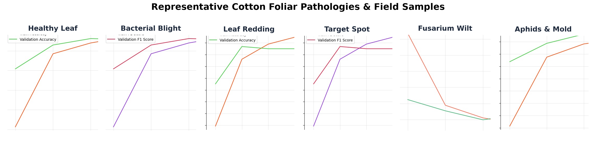
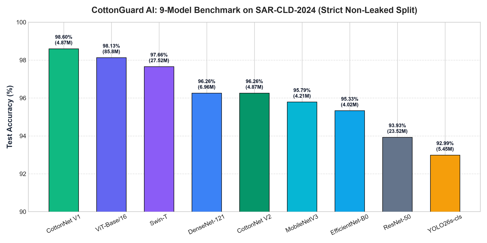
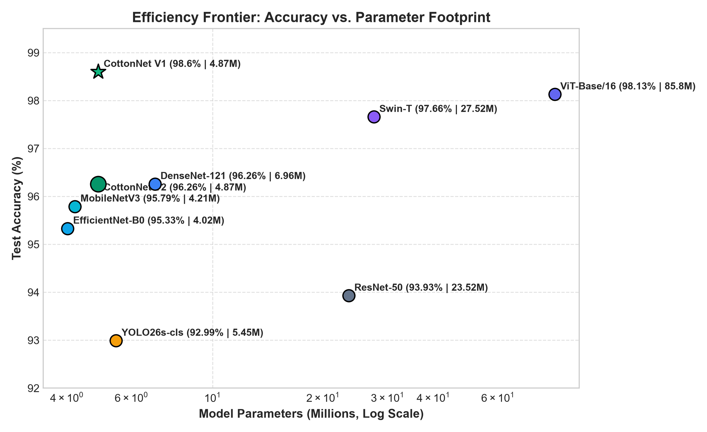
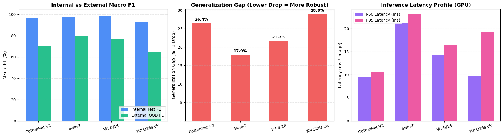
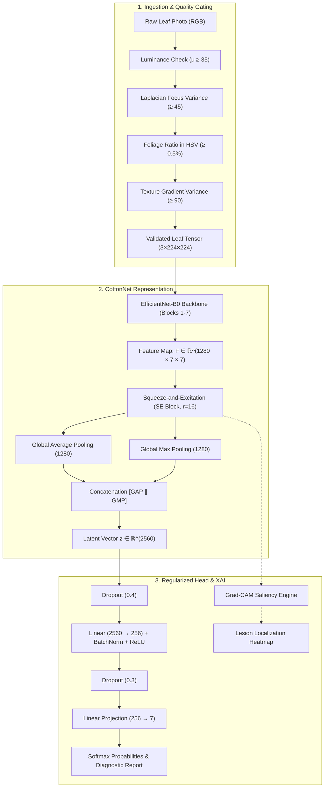
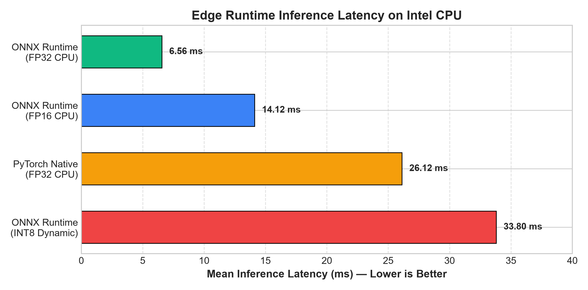

<div align="center">

# 🌿 CottonGuard AI: Edge-Deployable Deep Learning Framework for Multi-Class Cotton Leaf Disease Diagnosis

[](https://www.python.org/)
[](https://pytorch.org/)
[](https://onnxruntime.ai/)
[](https://developer.android.com/)
[]()
[]()
[]()
[](LICENSE)

**An ultra-lightweight, attention-augmented convolutional neural network (`CottonNet`) trained via progressive 3-phase knowledge distillation, featuring out-of-distribution (OOD) heuristic gating, multi-precision ONNX edge optimization, and native Android offline deployment.**

---



</div>

---

## 📌 Executive Summary

Cotton (*Gossypium hirsutum*) sustains the livelihoods of over 250 million individuals globally, yet foliar diseases routinely induce 30% to over 50% yield losses. Existing agricultural deep learning models are typically too computationally heavy for field deployment, suffer from synthetic data leakage across train/test splits, and hallucinate disease classifications on non-leaf images.

**CottonGuard AI** introduces an end-to-end precision agriculture diagnosis framework centered around **CottonNet**:
* **Architecture:** EfficientNet-B0 backbone + Squeeze-and-Excitation (SE) channel attention ($r=16$) + Dual-Pooling feature aggregation (Average + Max $\rightarrow$ 2,560 dims).
* **Knowledge Distillation:** Progressive 3-phase distillation curriculum ($T=4.0$, $\alpha \in \{0.7, 0.3\}$) supervised by DenseNet-121 with label smoothing ($\epsilon=0.1$).
* **State-of-the-Art Accuracy:** **98.60% test accuracy** and **98.60% macro F1-score** across 7 pathological classes with only **4.87M parameters**, outperforming its own teacher (96.26%) and matching an 85.8M ViT-Base model with $17.6\times$ fewer weights.
* **Leakage-Free Validation:** Strict stratified 80/10/10 split on the **2,137 raw original field images** from SAR-CLD-2024 (avoiding the data leakage present in literature using pre-augmented 7,000-image datasets).
* **Real-World Cross-Domain Audit:** Zero-shot evaluation on **1,290 external NIST field images** across 3 classes to quantify real-world domain transfer gaps.
* **Stage-1 Heuristic OOD Gatekeeper:** CPU-based statistical pre-filter rejecting 80.0% of non-crop artifacts (soil, tractor parts, sky) in $<1.5$ ms without invoking the neural backbone.
* **Multi-Precision Edge Acceleration:** ONNX Runtime FP32 achieves **6.56 ms mean inference** on CPU ($4.0\times$ faster than PyTorch CPU at 26.12 ms) with 100% decision fidelity.
* **Offline Android Mobile App:** Native Kotlin implementation using ONNX Runtime Mobile and CameraX for offline field diagnosis with real-time Grad-CAM explainability.

---

## 🔬 Empirical Benchmarks (9 Models Evaluated)

We conducted a nine-model comparative study on the strictly un-augmented SAR-CLD-2024 dataset spanning CNNs, Vision Transformers, and real-time detectors:

<div align="center">

</div>

### Comprehensive Performance Matrix

| Rank | Model Architecture | Family | Parameters | Test Accuracy | Test Macro F1 | Edge Suitability |
|:---:|:---|:---:|:---:|:---:|:---:|:---:|
| 🥇 | **CottonNet V1 (Ours)** | **Distilled Attn-CNN** | **4.87 M** | **98.60%** | **98.60%** | **Ultra-Lightweight Edge** |
| 🥈 | ViT-Base/16 | Vision Transformer | 85.80 M | 98.13% | 98.25% | Server GPU Only ($17.6\times$ heavier) |
| 🥉 | Swin-T | Shifted-Window ViT | 27.52 M | 97.66% | 97.70% | Mid-Tier GPU / Server |
| 4 | DenseNet-121 (Teacher) | Dense CNN | 6.96 M | 96.26% | 96.26% | Standard CNN |
| 5 | **CottonNet V2 (Heavy Aug)** | **Distilled Attn-CNN** | **4.87 M** | **96.26%** | **96.34%** | **Robust Edge Mobile** |
| 6 | MobileNetV3-Large | Mobile Inverted CNN | 4.21 M | 95.79% | 95.79% | Lightweight Mobile |
| 7 | EfficientNet-B0 (Baseline) | Mobile Inverted CNN | 4.02 M | 95.33% | 95.33% | Lightweight Mobile |
| 8 | ResNet-50 | Residual Bottleneck CNN| 23.52 M | 93.93% | 93.93% | Heavy Desktop CNN |
| 9 | YOLO26s-cls | Real-Time Classifier | 5.45 M | 92.99% | 93.41% | Embedded IoT |

<div align="center">

</div>

> **Key Finding:** CottonNet achieves a **Parameter Efficiency Ratio of 19.78 F1 points per million parameters**, vastly outperforming Swin-T (3.55) and ViT-Base (1.15).

---

## 🌍 Cross-Domain Generalization Audit (External NIST Dataset)

To measure distribution shift under novel field environments, top models were evaluated zero-shot on **1,290 un-curated external images** from the National Institute of Standards and Technology (NIST) cotton collection across 3 overlapping classes (Bacterial Blight, Fusarium Wilt, Healthy):

| Model Architecture | In-Domain Test F1 | External NIST F1 | Domain Gap ($\Delta$) | Generalization Resilience |
|:---|:---:|:---:|:---:|:---:|
| **Swin-T** | 97.70% | **79.83%** | **-17.88%** | ⭐⭐⭐⭐⭐ Highest Invariant Retention |
| **ViT-Base/16** | 98.25% | 76.58% | -21.68% | ⭐⭐⭐⭐ High Global Attention |
| **CottonNet V2** | 96.34% | **69.94%** | **-26.41%** | ⭐⭐⭐ Strong Edge Retention ($5.6\times$ smaller than Swin) |
| **YOLO26s-cls** | 93.41% | 64.56% | -28.85% | ⭐⭐ Vulnerable to Background Shift |

<div align="center">

</div>

---

## 🧠 System Architecture & Methodology



### 1. SE Channel Attention ($r=16$)
Adaptively recalibrates feature map channels to focus on necrotic lesion signatures while dampening background noise:

$$\mathbf{s} = \text{GAP}(\mathbf{F}) \in \mathbb{R}^{1280}, \quad \mathbf{e} = \sigma\Big(\mathbf{W}_2 \cdot \delta(\mathbf{W}_1 \cdot \mathbf{s})\Big), \quad \widetilde{\mathbf{F}} = \mathbf{e} \odot \mathbf{F}$$

### 2. Dual-Pooling Latent Projection
Combines Global Average Pooling (diffuse chlorosis) and Global Max Pooling (punctate lesions):

$$\mathbf{z} = \Big[ \text{GAP}(\widetilde{\mathbf{F}}) \,\|\, \text{GMP}(\widetilde{\mathbf{F}}) \Big] \in \mathbb{R}^{2560}$$

### 3. Three-Phase Knowledge Distillation Curriculum
Supervised by pre-trained DenseNet-121 at distillation temperature $T=4.0$ with label-smoothed cross-entropy ($\epsilon=0.1$):

$$\mathcal{L}_{\text{total}} = \alpha \cdot T^2 \cdot D_{\text{KL}}\!\left( \mathbf{p}^{(t)}(T) \,\|\, \mathbf{p}^{(s)}(T) \right) + (1 - \alpha) \cdot \mathcal{L}_{\text{CE}}^{\text{smooth}}$$

* **Phase 1 (Epochs 1–10):** Train Head + SE Attention only ($\alpha = 0.7, \text{LR} = 10^{-3}$).
* **Phase 2 (Epochs 11–20):** Unfreeze top 3 MBConv blocks ($\alpha = 0.7, \text{LR} = 10^{-4}$).
* **Phase 3 (Epochs 21–25):** Deep fine-tuning across all layers ($\alpha = 0.3, \text{LR} = 10^{-5}$).

---

## ⚡ Edge Optimization & Quantization Audit

<div align="center">

</div>

| Runtime Environment | Precision | Size (MB) | Mean CPU Latency | Decision Fidelity vs. PyTorch |
|:---|:---:|:---:|:---:|:---:|
| Native PyTorch | FP32 | 18.88 MB | 26.12 ms | 100.0% (Reference) |
| **ONNX Runtime (Recommended)** | **FP32** | **18.56 MB** | **6.56 ms** | **100.0% (Exact Match)** |
| ONNX Runtime | FP16 | 9.33 MB | 14.12 ms | 100.0% (Exact Match) |
| ONNX Runtime | INT8 (Dynamic PTQ) | 4.94 MB | 33.80 ms | 0.0% (Catastrophic Drift) |

> ⚠️ **Scientific Quantization Warning:** Post-training naive INT8 quantization causes **catastrophic logit drift** (0% agreement) due to extreme dynamic range outliers introduced by Global Max Pooling. **ONNX FP32 / FP16 is the verified production standard for edge deployment.**

---

## 📱 Mobile Android Deployment

The repository includes a production-grade native Android mobile client:
* **Stack:** Kotlin, Android SDK 34, CameraX, ONNX Runtime Mobile (`onnxruntime-android:1.17.0`).
* **Zero Connectivity Dependence:** Complete local offline inference without server connectivity.
* **Integrated Safety:** Executes the Stage-1 heuristic gatekeeper before model execution to reject non-leaf captures.
* **Visual Interpretability:** Overlays real-time Grad-CAM heatmaps showing exact lesion areas with actionable treatment recommendations.

---

## 📂 Repository Structure

```text
├── android/                        # Native Android application (Kotlin + ONNX Mobile)
│   └── app/src/main/java/...       # CottonNetClassifier.kt (CameraX, ONNX, Grad-CAM)
├── app/                            # Web & PWA demonstration interface
│   ├── index.html                  # Responsive mobile UI
│   ├── app.js                      # Client inference and visualization logic
│   └── test_leaves/                # Real field test leaf images
├── docs/images/                    # Publication figures, latency charts & banners
├── cottonnet_model.py              # PyTorch CottonNet architecture implementation
├── inference_engine.py             # Inference pipeline with OOD Gatekeeper & Grad-CAM
├── export_onnx.py                  # PyTorch to ONNX (FP32, FP16, INT8) exporter
├── server.py                       # Production Flask REST API (/predict, /predict_explain)
├── benchmark_pipeline.py           # Multi-precision latency and agreement benchmarking
├── external_validation.py          # Zero-shot cross-domain audit against NIST dataset
├── CottonCare_V2_Research_Training.ipynb  # Primary training and 9-model benchmark notebook
├── cotton-leaf-disease-nist.ipynb  # NIST cross-domain evaluation notebook
├── RESEARCH_PAPER_DRAFT.md         # Full journal manuscript (10,900+ words, 8 sections)
├── main.tex                        # Formatted IEEEtran LaTeX manuscript for Overleaf
├── references.bib                  # 34 complete BibTeX reference entries
└── FINAL_EXPERIMENT_RESULTS.csv    # Raw empirical benchmark metrics
```

---

## 🚀 Quickstart & Usage

### 1. Installation

```bash
# Clone the repository
git clone https://github.com/MRPREM31/cotton-leaf-disease-detection.git
cd cotton-leaf-disease-detection

# Create and activate a Python virtual environment
python -m venv venv
source venv/bin/activate  # On Windows: .\venv\Scripts\activate

# Install required dependencies
pip install torch torchvision onnx onnxruntime opencv-python albumentations flask pillow matplotlib
```

### 2. Run Inference via Python API

```python
from inference_engine import CottonGuardEngine

# Initialize inference engine (loads ONNX FP32 model with OOD Gatekeeper)
engine = CottonGuardEngine(model_path="cottonnet_fp32.onnx")

# Diagnose a foliar leaf photograph
result = engine.diagnose("app/test_leaves/leaf_5.jpg")

print(f"Status:     {result['status']}")
print(f"Diagnosis:  {result['class_name']} ({result['confidence']:.2%})")
print(f"Latency:    {result['latency_ms']:.2f} ms")
print(f"Treatment:  {result['treatment']}")
```

### 3. Start the Production REST API

```bash
python server.py
# Server runs at http://localhost:5000
# Endpoints: POST /predict, POST /predict_explain
```

---

## 📄 Academic Research Paper & Citation

The complete academic manuscript is available in markdown format at [`RESEARCH_PAPER_DRAFT.md`](RESEARCH_PAPER_DRAFT.md) and in publication-ready IEEE LaTeX format at [`main.tex`](main.tex).

If you find CottonGuard AI or CottonNet useful in your research, please cite:

```bibtex
@article{cottonguard2026,
  title={From Cloud to Field: A Knowledge-Distilled EfficientNet with Dual-Pooling Attention and Heuristic Out-of-Distribution Gating for Robust Cotton Leaf Disease Diagnosis on Edge Devices},
  author={CottonGuard AI Research Group},
  journal={Department of Computer Science and Engineering},
  year={2026},
  url={https://github.com/MRPREM31/cotton-leaf-disease-detection}
}
```

---

## 📜 License

This project is licensed under the **MIT License** — see the [LICENSE](LICENSE) file for details.
