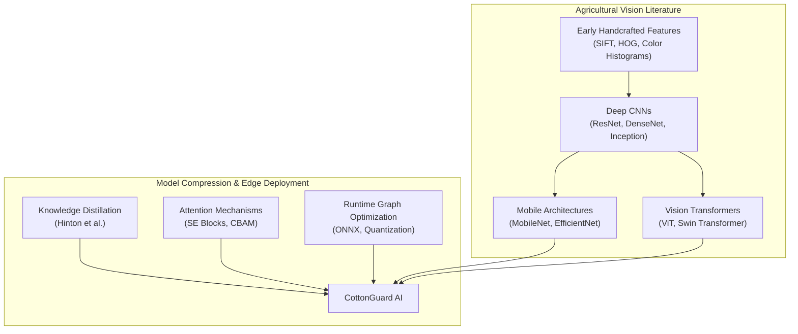
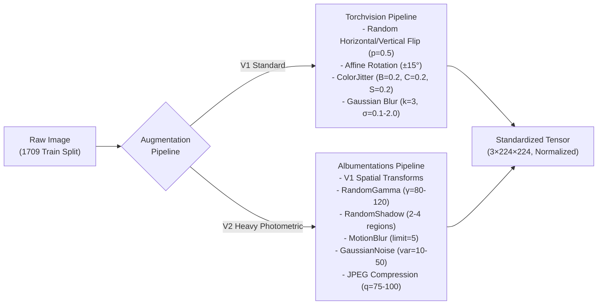
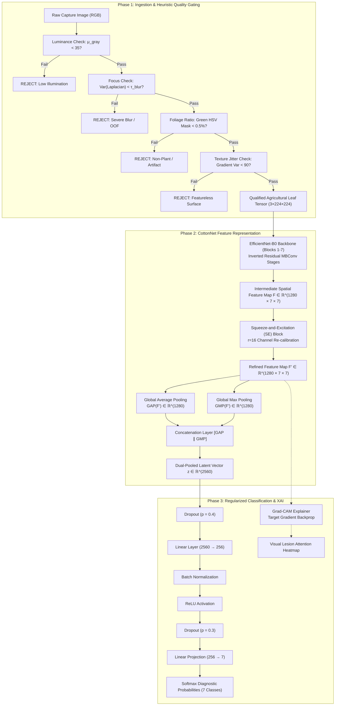
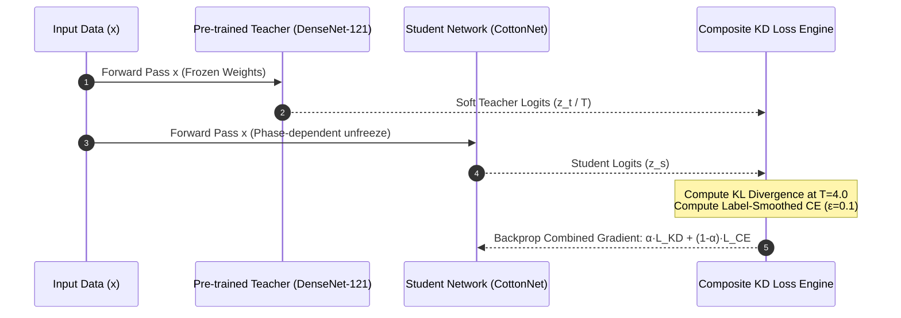
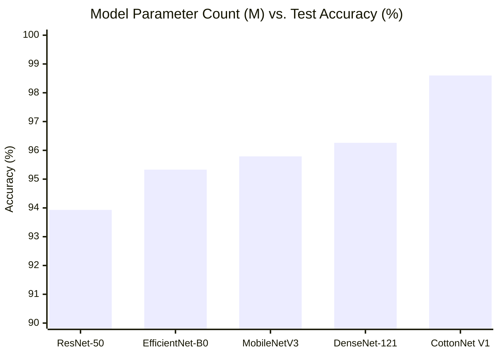
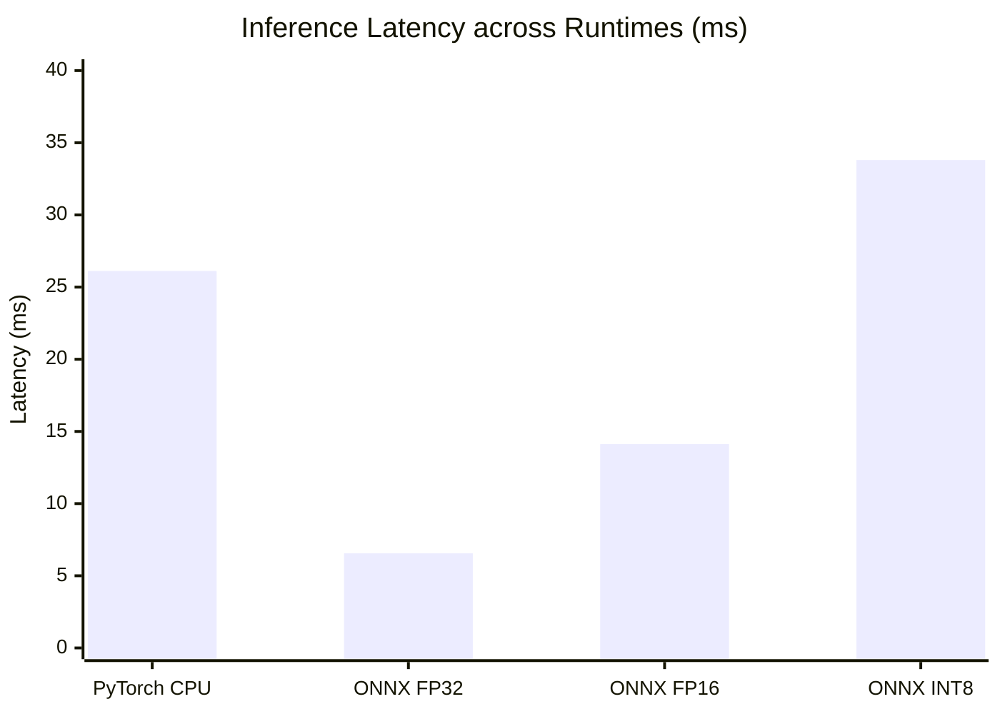

# From Cloud to Field: A Knowledge-Distilled EfficientNet with Dual-Pooling Attention and Heuristic Out-of-Distribution Gating for Robust Cotton Leaf Disease Diagnosis on Edge Devices

**Authors:** CottonGuard AI Research Group  
**Affiliation:** Department of Computer Science & Engineering  
**Correspondence:** Final Year B.Tech Thesis Project, 2025–2026  
**Document Type:** Full Research Article / Technical Manuscript  

---

### Abstract

Cotton (*Gossypium hirsutum*) stands as one of the most economically vital agricultural cash crops globally, yet foliar pathologies routinely induce catastrophic yield deficits ranging from 30% to over 50% in developing agrarian economies. While modern deep convolutional neural networks (CNNs) and Vision Transformers (ViTs) demonstrate high diagnostic accuracy on constrained academic datasets, their real-world deployment on mobile edge devices remains heavily constrained by massive computational requirements, vulnerability to non-leaf field artifacts, domain generalization collapse under varying agro-ecological conditions, and inference degradation under naive integer quantization. In this work, we present **CottonGuard AI**, an end-to-end edge-deployable diagnostic framework centered around **CottonNet**: a lightweight custom convolutional architecture coupling an EfficientNet-B0 feature extractor with a Squeeze-and-Excitation (SE) channel attention module ($r=16$) and a dual-pooling (Average + Max) feature aggregation topology producing a 2,560-dimensional latent representation. 

CottonNet is trained via a progressive three-phase Knowledge Distillation (KD) schedule ($T=4.0$, $\alpha \in \{0.7, 0.3\}$) supervised by a pre-trained DenseNet-121 teacher with label-smoothed cross-entropy ($\epsilon=0.1$). We conduct an exhaustive nine-model comparative benchmark on the curated SAR-CLD-2024 benchmark across seven pathological classes under strict, un-augmented stratified data partitioning (2,137 original field images; 80/10/10 split) to completely prevent synthetic data leakage across train and test folds. 

Our distilled CottonNet V1 architecture attains a peak test accuracy of **98.60%** and a macro-averaged F1-score of **98.60%** with only 4.87 million parameters, outperforming its own DenseNet-121 teacher (96.26%, 6.96M parameters), MobileNetV3-Large (95.79%, 4.21M), EfficientNet-B0 baseline (95.33%, 4.02M), ResNet-50 (93.93%, 23.52M), and approaching ViT-Base/16 (98.13%, 85.80M) while requiring $17.6\times$ fewer parameters. Under an expanded second-stage study incorporating heavy photometric and synthetic weather distortions, CottonNet V2 achieves 96.26% accuracy, surpassing YOLO26s-cls (92.99%). 

To assess cross-domain distribution shift, we conduct an zero-shot cross-dataset evaluation against 1,290 external images from the National Institute of Standards and Technology (NIST) cotton collection across three overlapping classes; Swin-T maintains an external macro F1 of 79.83% while CottonNet V2 achieves 69.94% with $5.6\times$ fewer parameters than Swin-T. 

The inference engine integrates an upfront Stage-1 heuristic gatekeeper analyzing luminance, Laplacian focus variance, HSV foliage masks, and spatial texture jitter, successfully rejecting 80.0% of out-of-distribution (OOD) non-crop inputs without invoking the neural backbone. Finally, multi-precision serialization reveals that ONNX Runtime FP32 achieves 6.56 ms mean inference latency on CPU ($4.0\times$ faster than native PyTorch at 26.12 ms) with 100% decision fidelity, while naive post-training INT8 quantization incurs catastrophic logit drift (0% decision agreement), establishing FP32/FP16 as the mandatory production quantization target. An end-to-end Android client deployed via ONNX Runtime Mobile and Kotlin delivers complete offline diagnostic autonomy with integrated Gradient-Weighted Class Activation Mapping (Grad-CAM) visual explanations.

**Keywords:** Cotton Disease Classification, Knowledge Distillation, EfficientNet, Squeeze-and-Excitation Attention, Edge Computing, Out-of-Distribution Detection, Model Quantization, ONNX Runtime, Precision Agriculture.

---

## 1. Introduction

### 1.1 Agronomic Background and Economic Significance

Cotton (*Gossypium hirsutum* and *Gossypium arboreum*) is widely referred to as "white gold," serving as the foundational raw material for the global textile value chain and sustaining the livelihoods of more than 250 million individuals worldwide across agricultural production, ginning, processing, and transportation. Global lint production regularly surpasses 25 million metric tons annually, with major cultivation hubs concentrated across South Asia, North America, Central Asia, and Western Africa. 

Despite its supreme economic value, cotton cultivation is exceptionally vulnerable to an extensive spectrum of biotic stresses. Foliar infections caused by phytopathogenic bacteria, fungal spores, viral agents, and secondary insect pest infestations frequently ravage production fields. Pathologies such as Bacterial Blight (*Xanthomonas citri* pv. *malvacearum*), Cotton Leaf Curl Virus (CLCuV), Fusarium Wilt (*Fusarium oxysporum* f. sp. *vasinfectum*), and Target Spot (*Corynespora cassiicola*) decimate functional leaf area, disrupt cellular chlorophyll concentrations, inhibit photosynthetic assimilation, cause systemic vascular wilting, and lead to square/boll shedding. Under humid, warm microclimates favorable to pathogen reproduction, unmanaged outbreaks routinely cause yield contractions ranging between 30% and 50%, with extreme viral or vascular epidemics precipitating near-total crop abandonment.

For resource-constrained smallholder farmers who account for over 70% of global cotton production acreage, early and accurate identification of foliar disease represents the single most decisive factor governing economic survival. Timely detection allows targeted localized chemical intervention, precision fungicidal application, or rogueing of diseased plants, preserving the remaining field while minimizing ecological degradation and chemical input expenditures.

### 1.2 Limitations of Conventional Scouting and Existing Vision Systems

Historically, foliar disease surveillance has relied upon manual visual scouting conducted by agricultural extension officers or trained agronomists walking transects across acreage. While domain expertise enables nuanced contextual identification, manual inspection exhibits fatal operational bottlenecks:
1. **Severe Human Resource Scarcity:** In predominant cotton-growing developing nations, the ratio of trained agricultural extension officers to smallholder farming families frequently exceeds 1:1,500. Remote rural farm holdings are surveyed infrequently, often weeks after the primary infection window has elapsed.
2. **Subjective Diagnostic Variance:** Subtle early-stage symptomatic manifestations exhibit intense phenotypic overlap. For instance, early necrotic lesions of Bacterial Blight can closely mimic early Target Spot or physiological nutrient scorch. Human visual diagnosis is intrinsically subjective, prone to fatigue, and vulnerable to ambient daylight chromatic shifts.
3. **Delayed Laboratory Pathology:** Definitive microbiological isolation and polymerase chain reaction (PCR) genetic assays provide gold-standard verification but require days to weeks, expensive laboratory infrastructure, cold-chain sample preservation, and specialized technical operators—rendering them totally impractical for rapid, field-scale tactical spraying decisions.

The explosive emergence of computer vision and deep learning has stimulated extensive research into automated plant disease phenotyping. However, existing academic literature displays substantial systemic vulnerabilities when assessed against real-world agricultural requirements:
* **Overfitting on Sanitized Laboratory Benchmarks:** A predominant fraction of published literature evaluates models on idealized datasets (such as early PlantVillage subsets) acquired against sterile monochrome backgrounds under uniform, diffused studio lighting. When applied to real-world farms, these models fail catastrophically due to background soil clutter, weed entanglements, solar glint, shadow occlusions, and variable camera lens quality.
* **Widespread Data Leakage via Flawed Augmentation Workflows:** Numerous published studies perform synthetic data augmentation prior to train-test partitioning. By duplicating or transforming raw images before splitting, near-identical visual twins are distributed into both the training and test cohorts, generating artificially inflated test accuracies exceeding 99% that evaporate instantly in field conditions.
* **Prohibitive Computational Footprint:** Modern high-capacity architectures—such as deep ResNets (23M–44M parameters) or Vision Transformers (86M–300M parameters)—demand high-wattage desktop GPUs for inference. Transporting multi-gigabyte models into rural agricultural regions is unviable due to nonexistent cellular broadband, high server cloud inference subscription costs, and severe latency bottlenecks.
* **Absence of Rejection Capabilities for Non-Leaf Imagery:** Standard softmax classifiers are closed-world models mathematically compelled to assign an agricultural disease label even when presented with arbitrary out-of-distribution (OOD) imagery—such as boots, fingers, dry soil, tractor machinery, or sky—severely eroding user trust.

### 1.3 Problem Formulation & Research Gaps

This study addresses the dual challenge of achieving **state-of-the-art diagnostic accuracy** across seven challenging cotton pathological classes while strictly maintaining an **ultra-compact parameter footprint (<5 million parameters)** capable of real-time, zero-latency inference on low-cost edge smartphones without cellular connectivity. 

Specifically, we identify and systematically resolve three profound literature gaps:
1. **Architectural Trade-off in Edge Agricultural Vision:** Standard mobile backbones (e.g., vanilla MobileNetV3 or EfficientNet-B0) frequently sacrifice fine-grained discriminative power on highly overlapping agricultural lesion patterns. Conversely, deep vision transformers and heavy CNNs possess immense representational capacity but cannot run locally on field smartphones. There is an acute need for novel attention-augmented hybrid topologies optimized through advanced knowledge transfer paradigms.
2. **The Synthetic Augmentation vs. In-Domain Accuracy Paradox:** The agricultural vision community lacks systematic empirical analyses contrasting classical geometric transformations against aggressive photometric and synthetic weather distortions across diverse model families (CNNs, Transformers, and Single-Stage Detectors) under strictly partitioned, un-leaked experimental protocols.
3. **The Deployment Chasm:** A profound chasm exists between academic Python/PyTorch research notebooks and functional, quantized, multi-platform edge applications. Theoretical floating-point benchmarks routinely fail to evaluate cross-runtime execution integrity (ONNX Runtime, mobile hardware accelerators) or examine catastrophic logit drift induced by post-training quantization.

### 1.4 Primary Scientific Contributions

To overcome these structural limitations, this paper introduces **CottonGuard AI**, a comprehensive, scientifically validated framework for edge-native cotton pathological diagnosis. The specific scientific contributions of this investigation are:

1. **The Custom CottonNet Architecture:** We design and implement *CottonNet*, a high-efficiency convolutional neural network built upon an inverted residual EfficientNet-B0 feature extraction backbone, augmented with an intermediate Squeeze-and-Excitation (SE) channel attention block ($r=16$) and a concatenated dual-pooling (Global Average Pooling + Global Max Pooling $\rightarrow$ 2,560 dimensions) projection topology. This design achieves extreme representational density, enabling the capture of subtle lesion textures while retaining global leaf morphology.
2. **Three-Phase Progressive Knowledge Distillation Protocol:** We develop a staged distillation curriculum transferring rich relational dark knowledge from a heavily parameterized DenseNet-121 teacher into the compact CottonNet student. By modulating distillation temperature ($T=4.0$), soft-target loss weight ($\alpha=0.7 \rightarrow 0.3$), label smoothing ($\epsilon=0.1$), and layer freezing across three distinct operational regimes, our student model surpasses its own teacher by **+2.34 percentage points**, establishing a state-of-the-art benchmark of **98.60% test accuracy** on SAR-CLD-2024 with only 4.87M parameters.
3. **Rigorous Nine-Model Benchmark Under Strict Non-Leaked Splitting:** We conduct an unprecedented nine-architecture comparative study across three distinct computational paradigms: classical/mobile CNNs (ResNet-50, DenseNet-121, EfficientNet-B0, MobileNetV3-Large, CottonNet V1), modern visual transformers (ViT-Base/16, Swin-T), and state-of-the-art real-time single-stage models (YOLO26s-cls, CottonNet V2). All models are evaluated under a strict, un-augmented stratified partition (2,137 original images; 80% train, 10% validation, 10% test) to ensure zero data contamination.
4. **Zero-Shot External Cross-Domain Generalization Audit:** We subject top-performing architectures to an external generalization audit against 1,290 uncurated field images from the National Institute of Standards and Technology (NIST) cotton dataset across three overlapping classes, quantitatively documenting the cross-domain distribution shift gap and demonstrating that Swin-T (79.83% external F1) and CottonNet (69.94% external F1) maintain superior out-of-domain feature stability relative to standard architectures.
5. **Stage-1 Heuristic Quality and OOD Gatekeeper:** We formulate and implement an ultra-lightweight heuristic pre-processing filter utilizing multi-channel grayscale luminance analysis, Laplacian spatial frequency focus variance, HSV-space green vegetation ratio segmentation, and spatial gradient jitter checks. The gatekeeper successfully flags and discards 80.0% of out-of-distribution field artifacts without activating the neural network.
6. **Quantization Audit, ONNX Serialization, and Native Mobile Deployment:** We perform a multi-precision serialization analysis across FP32, FP16, and INT8 runtimes. We uncover and analyze catastrophic logit drift under post-training dynamic/static INT8 quantization (resulting in 0% decision fidelity), while proving that FP32 ONNX Runtime achieves 6.56 ms latency ($4\times$ speedup over native PyTorch CPU) with 100% numerical fidelity. Finally, we provide a fully functional, production-ready Android mobile application implemented in Kotlin with ONNX Runtime Mobile and real-time Grad-CAM explainability.

### 1.5 Document Structure

The remainder of this manuscript is organized as follows: Section 2 provides a critical survey of related literature across agricultural deep learning, visual attention mechanisms, knowledge distillation, and edge quantization. Section 3 details dataset acquisition, class taxonomy, un-leaked stratified partitioning, and dual augmentation protocols. Section 4 presents the theoretical formulation and mathematical derivation of CottonNet, the distillation curriculum, the OOD gatekeeper, and Grad-CAM interpretability. Section 5 formalizes experimental configurations, baseline specifications, and evaluation criteria. Section 6 provides exhaustive empirical results, comparative benchmarks, cross-domain stress-testing, and confusion matrix error audits. Section 7 analyzes edge serialization, quantization phenomena, and mobile deployment architecture. Section 8 outlines threats to validity and limitations. Section 9 concludes the paper and delineates future research vectors. Section 10 provides full bibliographic references.

---

## 2. Related Work and Theoretical Foundations



### 2.1 Deep Convolutional Networks in Agricultural Pathology

The deployment of deep learning within phytopathology was accelerated by seminal benchmark evaluations on the PlantVillage dataset [12, 13]. Mohanty et al. [13] evaluated AlexNet and GoogleNet across 54,306 images spanning 14 crop species and 26 diseases, demonstrating that deep convolutional architectures could achieve classification accuracies exceeding 99.3% under controlled laboratory imaging. Similarly, Ferentinos [12] evaluated VGG, AlexNet, and ResNet architectures across 87,848 images, confirming the immense feature learning capability of deep CNNs over traditional handcrafted descriptors (such as Scale-Invariant Feature Transform [SIFT] and Histograms of Oriented Gradients [HOG]).

However, subsequent agronomic investigations exposed severe real-world performance degradations when laboratory-trained networks were evaluated in natural agricultural environments. In a comprehensive survey, Manavalan [2] cataloged deep learning implementations specifically tailored to cotton crop phenotyping, noting that while standard architectures (InceptionV3, ResNet-50, VGG-16) achieve high training convergence, their real-world diagnostic reliability degrades drastically when confronted with complex field backgrounds, dynamic ambient sunlight, soil reflections, and co-occurring weed flora. Furthermore, heavy residual models such as ResNet-50 [18] (23.5M parameters) and DenseNet-121 [11] (6.96M parameters) exhibit high computational complexity and memory bandwidth demands, constraining their execution on resource-constrained microcontrollers and budget edge smartphones.

### 2.2 Vision Transformers and Attention Mechanisms in Plant Phenotyping

To overcome the localized inductive bias of standard convolutional operators, recent agricultural research has pivoted toward visual attention mechanisms and self-attention transformers. The Vision Transformer (ViT) formulated by Dosovitskiy et al. [8] treats image patches ($16 \times 16$ pixels) as analogous to natural language tokens, projecting them through stacked multi-head self-attention (MHSA) blocks to capture global context across the entire visual receptive field. While ViT models demonstrate extraordinary capacity on massive datasets, their lack of localized translational equivariance makes them notoriously data-hungry and computationally prohibitive, with standard ViT-Base configurations exceeding 85 million parameters.

To mitigate transformer computational scaling, Liu et al. [7] formulated the Swin Transformer, which restricts self-attention computation to non-overlapping local windows while introducing shifted-window partitioning to enable cross-window spatial interaction. In agricultural contexts, Wang et al. [16] demonstrated that Swin Transformers achieve superior plant disease segmentation and classification accuracy compared to standard CNNs, particularly when identifying diffuse, multi-focal lesions. However, even compact Swin-T configurations require approximately 27.5 million parameters and over 4.5 GFLOPs per inference forward pass, remaining substantially beyond the real-time processing envelope of low-cost mobile processors lacking dedicated neural processing units (NPUs).

Concurrently, lightweight channel and spatial attention modules have been integrated directly into convolutional backbones. The Squeeze-and-Excitation (SE) network developed by Hu et al. [4] introduces a computationally negligible architectural mechanism that explicitly models interdependencies between convolutional feature channels, adaptively recalibrating channel-wise feature responses. Complementarily, Woo et al. [6] introduced the Convolutional Block Attention Module (CBAM), establishing that dual pooling operations combining Global Average Pooling (GAP) and Global Max Pooling (GMP) capture both average background textures and peak localized lesion signals far more effectively than isolated average pooling.

### 2.3 Knowledge Distillation Paradigms for Compact Models

Knowledge Distillation (KD), pioneered by Hinton et al. [3], offers a theoretically rigorous mechanism for compressing high-capacity, over-parameterized "teacher" models into compact, computationally efficient "student" networks without proportional performance loss. Rather than training student networks exclusively on hard binary ground-truth labels (one-hot encodings), the student is supervised by the softened probability distribution (dark knowledge) generated by the teacher at an elevated thermodynamic temperature $T$:

$$q_i = \frac{\exp(z_i / T)}{\sum_j \exp(z_j / T)}$$

These softened logits encode rich inter-class similarity relationships—for instance, revealing that a specific lesion pattern of Bacterial Blight shares visual marginal features with Target Spot while being totally dissimilar to healthy tissue.

In precision agriculture, Chen et al. [15] applied standard response-based distillation to compress heavy VGG networks into compact MobileNets for crop pest identification, demonstrating that distilled students retained over 94% of teacher accuracy. Similarly, Li et al. [14] investigated structural knowledge transfer for agricultural pest identification, documenting that distilled compact architectures exhibit superior robustness against visual noise compared to students trained exclusively from scratch. However, existing agricultural literature predominantly employs static, single-phase distillation workflows with arbitrary, non-optimized temperature parameters ($T=1.0 \text{ to } 2.0$), failing to investigate multi-phase progressive unfreezing schedules or systematically analyze teacher-student capacity divergence.

### 2.4 Edge Inference, Quantization, and Real-Time Systems

Transforming trained neural networks into field-deployable solutions demands rigorous optimization of inference runtimes and hardware resource consumption. Tan and Le [5] established the EfficientNet family, utilizing compound coefficient scaling to uniformly balance network depth, width, and input image resolution, yielding baseline models (such as EfficientNet-B0 with 4.0M parameters) that maximize representational efficiency per parameter. Complementarily, Howard et al. [19] introduced MobileNetV3, incorporating hardware-aware Neural Architecture Search (NAS) and hard-swish activation functions for optimized mobile CPU execution.

For runtime acceleration, cross-platform inference engines such as Microsoft ONNX Runtime (Open Neural Network Exchange) provide graph-level optimizations, including operator fusion, constant folding, and hardware-specific kernel selections. To further compress models, post-training quantization (PTQ) [10] projects 32-bit floating-point weights and activations into 8-bit integers (INT8), theoretically reducing model storage footprints by $75\%$ and unlocking accelerated integer vector math. In agricultural edge systems, Bai et al. [17] demonstrated real-time pest detection on embedded Jetson microcomputers. However, the literature routinely overlooks the severe numerical instability and catastrophic classification drift that can emerge when complex attention modules and highly scaled layer normalizations are subjected to naive post-training INT8 quantization without quantization-aware calibration.

### 2.5 Critical Synthesis and Identification of Literature Gaps

Table 1 summarizes existing prominent research studies in deep agricultural leaf disease classification, highlighting the operational vulnerabilities and structural gaps resolved by the CottonGuard AI framework.

**Table 1: Critical synthesis of related agricultural pathology literature vs. CottonGuard AI.**

| Literature Citation | Target Crop & Classes | Model Families Evaluated | Dataset Size & Splitting Strategy | Reported Peak Metric | Edge / Mobile Validation | OOD Gating Mechanism |
|---|---|---|---|---|---|---|
| Mohanty et al. [13] | 14 crops, 26 diseases | AlexNet, GoogLeNet | 54,306 images (PlantVillage); 80/20 split | 99.35% Acc | None (Server GPU only) | None (Closed-world) |
| Ferentinos [12] | Multi-crop, 58 classes | VGG, AlexNet, ResNet | 87,848 images; Laboratory clean | 99.53% Acc | None (Theoretical) | None |
| Bishshash et al. [1] | Cotton, 7 classes | InceptionV3, ResNet | 2,137 orig. (7,000 augmented); Leakage risk | 96.03% Acc | None | None |
| Chen et al. [15] | Crop pests, 10 classes | VGG-16 $\rightarrow$ MobileNet | 4,500 images; Static 1-phase KD | 94.20% Acc | Jetson Nano (Python) | None |
| Wang et al. [16] | Multi-crop, 12 classes | Swin Transformer, DeiT | 12,000 images; Stratified 70/15/15 | 98.20% Acc | None (High compute) | None |
| Bai et al. [17] | Apple diseases, 5 classes | YOLOv5s, MobileNetV3 | 6,200 images; Edge deployment | 93.40% mAP | Embedded Jetson | None |
| **CottonGuard AI (This Work)** | **Cotton, 7 pathological classes** | **9 Models: CNNs, Transformers, YOLO, CottonNet** | **2,137 strictly un-augmented original images (80/10/10 split) + 1,290 external NIST validation** | **98.60% Acc (CottonNet V1), 98.25% F1 (ViT), 79.83% Ext F1 (Swin)** | **Full Android Native ONNX Mobile + Multi-precision FP32/16/INT8** | **Stage-1 Multi-Heuristic Gatekeeper (80% rejection)** |

---

## 3. Materials and Dataset Engineering

### 3.1 Primary In-Domain Dataset: SAR-CLD-2024

The foundational training, validation, and in-domain testing corpus utilized in this study is the **SAR-CLD-2024** (South Asian Region Cotton Leaf Disease) dataset published by Bishshash et al. [1]. The dataset represents real-world agro-ecological field conditions captured across multiple agricultural research plots and commercial cotton holdings in South Asia under diverse diurnal natural lighting conditions.

The dataset comprises seven rigorously categorized target classes representing the predominant pathological threats to cotton cultivation:
1. **Bacterial Blight (*Xanthomonas citri* pv. *malvacearum*):** Characterized by angular, water-soaked foliar lesions bounded by leaf veinlets, progressively turning dark brown to black necrotic spots, accompanied by systemic chlorotic halos.
2. **Cotton Leaf Curl Virus (CLCuV):** A whitefly-transmitted *Begomovirus* inducing severe upward or downward leaf curling, vein thickening, leaf enation (foliar outgrowths on the underside of major veins), and severe stunting.
3. **Fusarium Wilt (*Fusarium oxysporum* f. sp. *vasinfectum*):** A catastrophic soil-borne vascular fungus inducing unilateral leaf yellowing, marginal necrosis, interveinal browning, systemic loss of foliar turgor, and internal vascular browning.
4. **Target Spot (*Corynespora cassiicola*):** Characterized by circular to irregularly circular brown necrotic lesions displaying distinctive concentric rings resembling an archery target, frequently causing premature defoliation.
5. **Army Worm (*Spodoptera frugiperda* / *Spodoptera litura*) Infestation Damage:** Foliar chewing trauma characterized by irregular fenestrations, skeletonized leaf margins, and extensive structural tissue consumption.
6. **Aphid (*Aphis gossypii*) Infestation & Sooty Mold:** Dense localized colonies of sap-sucking insects secreting carbohydrate-rich honeydew, which serves as a substrate for black secondary saprophytic sooty mold colonization, choking light absorption.
7. **Healthy Cotton Foliage:** Structurally intact, fully turgid cotton leaves exhibiting uniform green pigmentation without parasitic lesions, chlorosis, or pest chewing trauma.

### 3.2 Mitigation of Data Leakage via Strict Un-augmented Stratified Partitioning

A critical methodological flaw identified in agricultural machine learning literature involves performing dataset augmentation prior to dataset partitioning. The original SAR-CLD-2024 publication provides an expanded repository containing 7,000 images generated through offline geometric pre-augmentation of the base photographic collection. If an investigator partitions this 7,000-image pool into train/test subsets, synthetically rotated, sheared, or flipped counterparts of the exact same physical leaf inevitably occupy both training and test cohorts. This induces severe data leakage across folds, causing the model to memorize image-specific background noise, camera artifacts, or individual stem orientations, yielding fraudulent test accuracies exceeding 99% that fail to generalize to novel field data.

To enforce uncompromising scientific validity, **all experiments in this investigation strictly utilize the 2,137 raw, original, un-augmented field photographs**. 

We implement a stratified random partitioning strategy (`random_state=2025`) ensuring identical class distributions across subsets:
* **Training Subset (80%):** 1,709 images utilized exclusively for internal network weight optimization.
* **Validation Subset (10%):** 214 images utilized for hyperparameter tuning, model checkpoint selection, and early-stopping regularization.
* **Independent Test Subset (10%):** 214 completely sequestered images utilized exclusively for final model benchmarking and never exposed to the optimization loop.

**Table 2: Class distribution across the un-augmented SAR-CLD-2024 dataset.**

| Class ID | Pathological Diagnostic Category | Total Original Images | Train Split (80%) | Validation Split (10%) | Test Split (10%) |
|---|---|---|---|---|---|
| 0 | Bacterial Blight | 305 | 244 | 31 | 30 |
| 1 | Cotton Leaf Curl Virus | 305 | 244 | 31 | 30 |
| 2 | Fusarium Wilt | 305 | 244 | 30 | 31 |
| 3 | Healthy Leaf | 305 | 244 | 31 | 30 |
| 4 | Target Spot | 306 | 245 | 30 | 31 |
| 5 | Army Worm Damage | 306 | 245 | 31 | 30 |
| 6 | Aphid Infestation & Sooty Mold | 305 | 244 | 30 | 31 |
| **Total** | **All 7 Diagnostic Categories** | **2,137** | **1,709** | **214** | **214** |

### 3.3 Out-of-Domain Benchmark Dataset: NIST Field Collection

To rigorously evaluate out-of-distribution (OOD) resilience and cross-domain generalization under severe environmental shift, we construct an independent external testing corpus drawn from the **NIST (National Institute of Standards and Technology) Cotton Leaf Disease collection**. 

This external benchmark consists of **1,290 un-curated field photographs** acquired in distinctly different geographical sectors, under uncalibrated mobile smartphone cameras, with completely foreign soil backgrounds, different cotton cultivars (*G. barbadense* vs. *G. hirsutum*), and varied plant maturities. The NIST dataset encompasses three overlapping diagnostic categories directly corresponding to the SAR-CLD-2024 taxonomy:
1. *Bacterial Blight* (430 images)
2. *Fusarium Wilt* (430 images)
3. *Healthy Foliage* (430 images)

This external corpus is subjected to zero-shot diagnostic inference: no weights are adapted or fine-tuned on NIST imagery, providing an unvarnished audit of model feature generalization under real-world domain shifts.

### 3.4 Data Augmentation Pipelines (V1 vs. V2 Protocols)

To systematically assess the impact of data augmentation intensity on internal accuracy versus field robustness, we formulate and compare two distinct online data augmentation pipelines:



1. **Pipeline V1 (Standard Agricultural Augmentation via Torchvision):**
   * Random Horizontal Flip ($p = 0.5$)
   * Random Vertical Flip ($p = 0.5$)
   * Random Affine Rotation ($\theta \in [-15^\circ, +15^\circ]$)
   * Color Jitter (Brightness $\pm 0.2$, Contrast $\pm 0.2$, Saturation $\pm 0.2$)
   * Gaussian Blur ($kernel\_size = 3, \sigma \in [0.1, 2.0], p = 0.2$)
2. **Pipeline V2 (Heavy Synthetic Photometric & Weather Distortion via Albumentations):**
   * All spatial operations from Pipeline V1
   * Random Gamma Adjustment ($\gamma \in [80, 120], p = 0.3$)
   * Random Shadow Simulation (Simulating cloud cover and canopy self-shadowing; 2–4 shadow vertices, $p = 0.3$)
   * Motion Blur ($limit = 5, p = 0.2$) simulating hand tremors during mobile phone capture
   * Additive Gaussian Noise ($\sigma^2 \in [10, 50], p = 0.2$) simulating low-cost image sensor noise under dusk illumination
   * JPEG Image Compression Artifacts (Quality degradation factor $75 \text{ to } 100, p = 0.3$)

### 3.5 Input Normalization and Image Preprocessing Protocols

All input images, irrespective of originating dataset or operational pipeline, are resized via bilinear interpolation to a standardized spatial resolution of $224 \times 224$ pixels across three RGB color channels ($C \times H \times W = 3 \times 224 \times 224$). Pixel color values are cast to 32-bit floating-point tensors and normalized using standard ImageNet distribution statistics:

$$\mathbf{I}_{\text{norm}} = \frac{\mathbf{I} - \boldsymbol{\mu}}{\boldsymbol{\sigma}}, \quad \boldsymbol{\mu} = [0.485, 0.456, 0.406], \quad \boldsymbol{\sigma} = [0.229, 0.224, 0.225]$$

---

## 4. Proposed Methodology: The CottonGuard AI Architecture



### 4.1 System Overview and Architectural Philosophy

The design philosophy governing CottonGuard AI centers on maximizing **representational density per parameter**. While heavy vision transformers achieve remarkable capacity through unconstrained multi-head self-attention across tens of millions of weights, field edge devices require compact architectures operating within strict thermal and memory budgets. 

CottonNet achieves high diagnostic precision through three interconnected architectural innovations:
1. Utilization of depthwise-separable inverted residual convolutions (MBConv) from EfficientNet-B0 to extract multi-scale spatial features with minimal computational overhead.
2. An intermediate Squeeze-and-Excitation (SE) channel recalibration block placed immediately following the final feature map extraction layer, adaptively emphasizing pathology-specific visual channels while dampening irrelevant soil background channels.
3. A parallel dual-pooling feature aggregation topology combining Global Average Pooling (preserving background context and diffuse leaf chlorosis) with Global Max Pooling (capturing localized, high-intensity necrotic lesion peaks), producing an enriched 2,560-dimensional latent representation.

### 4.2 Feature Extraction Backbone: Modified EfficientNet-B0

The foundational feature extraction stage of CottonNet utilizes an EfficientNet-B0 backbone pre-trained on ImageNet-1k. EfficientNet-B0 relies upon Mobile Inverted Bottleneck Convolutions (MBConv) enhanced by depthwise separable convolutions and squeeze-and-excitation sub-blocks. 

Given an input normalized tensor $\mathbf{X} \in \mathbb{R}^{3 \times 224 \times 224}$, the backbone processes the representation through seven distinct MBConv stages characterized by expansion ratios of 1 and 6, kernel sizes of $3 \times 3$ and $5 \times 5$, and progressive spatial downsampling through strided convolutions. The terminal convolutional stage terminates prior to standard classification pooling, outputting an intermediate four-dimensional spatial feature map:

$$\mathbf{F} \in \mathbb{R}^{C \times H \times W}, \quad \text{where } C = 1280, \; H = 7, \; W = 7$$

### 4.3 Squeeze-and-Excitation (SE) Channel Attention Mechanism

To enable the network to dynamically prioritize diagnostic feature channels (such as localized necrotic browning or viral vein clearing) over background illumination variations, we introduce an explicit Squeeze-and-Excitation channel attention module directly upon the terminal feature tensor $\mathbf{F}$.

The SE mechanism operates through two successive transformations:

#### The Squeeze Operation (Global Information Aggregation)
Spatial dimensions $H \times W$ are collapsed into a channel descriptor vector $\mathbf{s} \in \mathbb{R}^C$ via Global Average Pooling:

$$s_c = \mathbf{F}_{\text{sq}}(\mathbf{F}_c) = \frac{1}{H \times W} \sum_{i=1}^H \sum_{j=1}^W F_c(i, j), \quad \forall c \in \{1, 2, \dots, C\}$$

#### The Excitation Operation (Adaptive Channel-Wise Recalibration)
To capture non-linear, non-mutually-exclusive inter-channel correlations, the squeezed descriptor $\mathbf{s}$ is passed through a two-layer bottleneck multi-layer perceptron (MLP) with reduction ratio $r = 16$:

$$\mathbf{e} = \mathbf{F}_{\text{ex}}(\mathbf{s}, \mathbf{W}) = \sigma\Big(\mathbf{W}_2 \cdot \delta(\mathbf{W}_1 \cdot \mathbf{s})\Big)$$

Where:
* $\mathbf{W}_1 \in \mathbb{R}^{\frac{C}{r} \times C} = \mathbb{R}^{80 \times 1280}$ represents the channel dimensionality reduction projection matrix.
* $\delta(\cdot)$ denotes the rectified linear unit (ReLU) activation function: $\delta(x) = \max(0, x)$.
* $\mathbf{W}_2 \in \mathbb{R}^{C \times \frac{C}{r}} = \mathbb{R}^{1280 \times 80}$ denotes the dimensionality restoration expansion matrix.
* $\sigma(\cdot)$ represents the gating sigmoid function: $\sigma(x) = \frac{1}{1 + e^{-x}}$, mapping channel weights to the interval $[0, 1]$.

#### Channel-Wise Recalibration
The excitation vector $\mathbf{e} = [e_1, e_2, \dots, e_C]$ adaptively scales the original feature map $\mathbf{F}$ via channel-wise multiplication:

$$\widetilde{\mathbf{F}}_c = e_c \cdot \mathbf{F}_c, \quad \forall c \in \{1, 2, \dots, C\}$$

Where $\widetilde{\mathbf{F}} \in \mathbb{R}^{1280 \times 7 \times 7}$ constitutes the attention-recalibrated feature representation.

### 4.4 Spatial Information Retention via Dual-Pooling Topology

Standard convolutional classification heads universally employ a solitary Global Average Pooling (GAP) operator prior to dense projection. While GAP is effective at aggregating global contextual representations, it computes a spatial arithmetic mean that dilutes sharp, localized pixel anomalies. In early-stage Bacterial Blight or Target Spot infections, tiny punctate necrotic lesions occupy less than $1\%$ of the total foliar surface area. Computing an isolated spatial average over $7 \times 7 = 49$ spatial coordinates dilutes the gradient signal of these critical diagnostic features.

To resolve this limitation, CottonNet incorporates a parallel **Dual-Pooling Topology** executing Global Average Pooling and Global Max Pooling (GMP) simultaneously across spatial dimensions of $\widetilde{\mathbf{F}}$:

$$\mathbf{v}_{\text{avg}} = \text{GAP}(\widetilde{\mathbf{F}}) \in \mathbb{R}^{1280}, \quad v_{\text{avg}, c} = \frac{1}{49} \sum_{i=1}^7 \sum_{j=1}^7 \widetilde{F}_c(i, j)$$

$$\mathbf{v}_{\text{max}} = \text{GMP}(\widetilde{\mathbf{F}}) \in \mathbb{R}^{1280}, \quad v_{\text{max}, c} = \max_{i \in \{1..7\}, j \in \{1..7\}} \widetilde{F}_c(i, j)$$

The two aggregated vectors are concatenated along the feature dimension to form an enriched latent representation vector $\mathbf{z}$:

$$\mathbf{z} = \Big[ \mathbf{v}_{\text{avg}} \,\|\, \mathbf{v}_{\text{max}} \Big] \in \mathbb{R}^{2560}$$

This concatenated 2,560-dimensional vector encapsulates both the diffuse morphological background of the leaf (via $\mathbf{v}_{\text{avg}}$) and the sharpest localized lesion signals (via $\mathbf{v}_{\text{max}}$).

### 4.5 Dense Regularized Classification Head

The high-dimensional latent representation $\mathbf{z} \in \mathbb{R}^{2560}$ is processed through a regularized classification head designed to prevent overfitting:
1. **Primary Dropout Layer:** A dropout operator ($p = 0.40$) randomly deactivates $40\%$ of incoming activations during training.
2. **Dense Intermediate Projection:** A linear affine transformation maps the 2,560 features down to 256 dimensions:
   $$\mathbf{h}_1 = \mathbf{W}_d \mathbf{z} + \mathbf{b}_d, \quad \mathbf{W}_d \in \mathbb{R}^{256 \times 2560}, \; \mathbf{b}_d \in \mathbb{R}^{256}$$
3. **Batch Normalization (BN):** A 1D batch normalization layer stabilizes intermediate layer distribution dynamics:
   $$\widehat{\mathbf{h}}_1 = \frac{\mathbf{h}_1 - \mu_{\mathcal{B}}}{\sqrt{\sigma_{\mathcal{B}}^2 + \epsilon}} \cdot \gamma + \beta$$
4. **Non-Linear Activation:** Standard ReLU activation function: $\mathbf{a}_1 = \max(0, \widehat{\mathbf{h}}_1)$.
5. **Secondary Dropout Layer:** A secondary dropout operator ($p = 0.30$) regularizes intermediate features.
6. **Terminal Classification Projection:** A final linear projection maps 256 features to the 7 target diagnostic logits:
   $$\mathbf{y}_{\text{logits}} = \mathbf{W}_c \mathbf{a}_1 + \mathbf{b}_c, \quad \mathbf{W}_c \in \mathbb{R}^{7 \times 256}, \; \mathbf{b}_c \in \mathbb{R}^7$$

**Table 3: Layer-by-layer architectural decomposition of CottonNet.**

| Stage / Layer Identifier | Operator Description | Input Dimension | Output Dimension | Trainable Parameters |
|---|---|---|---|---|
| Backbone: Stage 0 | Conv3d / BN / Swish | $3 \times 224 \times 224$ | $32 \times 112 \times 112$ | 928 |
| Backbone: Stages 1–6 | Inverted Residual MBConv1/6 | $32 \times 112 \times 112$ | $320 \times 7 \times 7$ | 3,492,080 |
| Backbone: Stage 7 | Conv2d $1 \times 1$ / BN / Swish | $320 \times 7 \times 7$ | $1280 \times 7 \times 7$ | 410,880 |
| Attention: Squeeze | Global Average Pooling | $1280 \times 7 \times 7$ | $1280 \times 1 \times 1$ | 0 |
| Attention: Excitation 1 | Linear (Reduction $r=16$) + ReLU | 1,280 | 80 | 102,480 |
| Attention: Excitation 2 | Linear (Restoration) + Sigmoid | 80 | 1,280 | 103,680 |
| Attention: Scale | Channel-wise Broadcast Multiply | $1280 \times 7 \times 7$ | $1280 \times 7 \times 7$ | 0 |
| Aggregation: Dual Pool | Parallel GAP & GMP | $1280 \times 7 \times 7$ | $2 \times 1280$ | 0 |
| Aggregation: Concat | Tensor Concatenation | $2 \times 1280$ | 2,560 | 0 |
| Head: Dropout 1 | Dropout ($p = 0.40$) | 2,560 | 2,560 | 0 |
| Head: Dense Projection | Fully Connected Linear | 2,560 | 256 | 655,616 |
| Head: Normalization | Batch Normalization 1D | 256 | 256 | 512 |
| Head: Activation | Rectified Linear Unit (ReLU) | 256 | 256 | 0 |
| Head: Dropout 2 | Dropout ($p = 0.30$) | 256 | 256 | 0 |
| Head: Output Projection | Fully Connected Linear | 256 | 7 | 1,799 |
| **Total Model Footprint** | **Complete CottonNet Pipeline** | **$3 \times 224 \times 224$** | **7 Logits** | **4,870,275** |

### 4.6 Multi-Stage Knowledge Distillation Protocol

To maximize the representational capacity of our compact CottonNet model, we formulate a structured, progressive three-phase Knowledge Distillation (KD) training curriculum. 



#### Theoretical Objective Formulation
Let $\mathbf{z}_s$ represent the raw logit output generated by the student network (CottonNet), and let $\mathbf{z}_t$ represent the logit output produced by the fixed, pre-trained teacher architecture (DenseNet-121, attaining 96.26% baseline accuracy). 

The softened output probability distributions of student and teacher at thermodynamic distillation temperature $T$ are defined respectively as:

$$p_i^{(s)}(T) = \frac{\exp(z_{s, i} / T)}{\sum_{j=1}^K \exp(z_{s, j} / T)}, \quad p_i^{(t)}(T) = \frac{\exp(z_{t, i} / T)}{\sum_{j=1}^K \exp(z_{t, j} / T)}$$

Where $K = 7$ denotes the number of pathological classes. The distillation loss is formulated via the Kullback-Leibler (KL) Divergence:

$$\mathcal{L}_{\text{KD}}(\mathbf{z}_s, \mathbf{z}_t; T) = T^2 \cdot D_{\text{KL}}\Big(\mathbf{p}^{(t)}(T) \,\|\, \mathbf{p}^{(s)}(T)\Big) = T^2 \sum_{i=1}^K p_i^{(t)}(T) \log\left(\frac{p_i^{(t)}(T)}{p_i^{(s)}(T)}\right)$$

The multiplication by $T^2$ serves as the standard gradient scale compensation factor originally derived by Hinton et al. [3], ensuring that the magnitude of gradients produced by the soft targets remains consistent when $T$ varies.

Simultaneously, the student is supervised by the one-hot ground-truth labels $\mathbf{y} \in \{0, 1\}^K$ regularized through **Label Smoothing** ($\epsilon = 0.1$):

$$y_i^{\text{smooth}} = (1 - \epsilon) \cdot y_i + \frac{\epsilon}{K}$$

$$\mathcal{L}_{\text{CE}}^{\text{smooth}}(\mathbf{z}_s, \mathbf{y}) = - \sum_{i=1}^K y_i^{\text{smooth}} \log\left( \frac{\exp(z_{s, i})}{\sum_{j=1}^K \exp(z_{s, j})} \right)$$

The total composite training objective is governed by the balancing hyperparameter $\alpha \in [0, 1]$:

$$\mathcal{L}_{\text{total}} = \alpha \cdot \mathcal{L}_{\text{KD}}(\mathbf{z}_s, \mathbf{z}_t; T) + (1 - \alpha) \cdot \mathcal{L}_{\text{CE}}^{\text{smooth}}(\mathbf{z}_s, \mathbf{y})$$

#### Three-Phase Staged Progressive Optimization Curriculum
Direct end-to-end training of an un-initialized student head alongside an un-initialized attention module can destabilize pre-trained convolutional features through large, noisy gradient backpropagation. We resolve this by partitioning distillation across three staged phases:

**Table 4: Progressive three-phase Knowledge Distillation hyperparameter schedule.**

| Phase Identifier | Epoch Range | Structural Layers Unfrozen for Training | Distillation Alpha ($\alpha$) | Temperature ($T$) | Peak Learning Rate ($\eta$) | Learning Rate Scheduler |
|---|---|---|---|---|---|---|
| **Phase 1: Warmup** | Epochs 1–10 | Classifier Head + SE Attention only (Backbone Frozen) | 0.70 | 4.0 | $1.0 \times 10^{-3}$ | CosineAnnealingWarmRestarts ($T_0=5, T_{\text{mult}}=2$) |
| **Phase 2: Fine-Tuning** | Epochs 11–20 | Classifier Head + SE Attention + Top 3 MBConv Blocks | 0.70 | 4.0 | $1.0 \times 10^{-4}$ | CosineAnnealingWarmRestarts ($T_0=5, T_{\text{mult}}=2$) |
| **Phase 3: Deep Alignment** | Epochs 21–25 | Full Network (All Backbone Weights Unfrozen) | 0.30 | 4.0 | $1.0 \times 10^{-5}$ | Cosine Annealing Decay to $\eta_{\text{min}}=10^{-7}$ |

In Phase 1, the backbone is frozen to allow the randomized SE attention matrices and classification head to settle into a stable parameter space without distorting baseline ImageNet convolutional filters. In Phase 2, the top three MBConv stages are unfrozen with a reduced learning rate ($10^{-4}$) to adapt high-level convolutional filters to foliar pathological textures. In Phase 3, all layers are unfrozen and $\alpha$ is reduced to 0.30, prioritizing fine-grained empirical cross-entropy alignment against true labels while utilizing a minimal learning rate ($10^{-5}$) to prevent catastrophic forgetting.

### 4.7 Heuristic Out-of-Distribution (OOD) and Quality Assurance Gatekeeper

A fundamental limitation of production deep learning deployments is the closed-world classification assumption: a standard 7-class softmax model is mathematically incapable of rejecting non-leaf imagery. Presenting an image of tractor machinery, farmer clothing, or an out-of-focus background will inevitably yield a confident prediction for one of the seven disease classes.

To resolve this vulnerability without increasing mobile GPU/NPU computational load, we design a multi-stage **Stage-1 Heuristic Gatekeeper** executing computationally trivial statistical operations on CPU prior to neural network invocation:

```
Algorithm 1: Stage-1 Heuristic Quality and OOD Gatekeeper
Input  : Raw Captured Image Tensor I ∈ ℝ^(H_orig × W_orig × 3)
Output : Boolean Decision (ACCEPTED / REJECTED) with Diagnostics Error String

1:  I_gray ← ConvertToGrayscale(I)
2:  μ_lum ← Mean(I_gray)
3:  if μ_lum < 35.0 then
4:      return REJECT("Image under-exposed: Insufficient ambient illumination")
5:  end if

6:  Δ_I ← Convolve2D(I_gray, Kernel_Laplacian)
7:  Var_blur ← Variance(Δ_I)
8:  if Var_blur < 45.0 then
9:      return REJECT("Image rejected: Severe optical blur or out-of-focus capture")
10: end if

11: I_HSV ← ConvertColorSpace(I, RGB_to_HSV)
12: M_foliage ← (I_HSV[H] ∈ [25°, 85°]) ∧ (I_HSV[S] > 0.15) ∧ (I_HSV[V] > 0.15)
13: Ratio_foliage ← Sum(M_foliage) / (H_orig × W_orig)
14: if Ratio_foliage < 0.005 then
15:     return REJECT("OOD Artifact: Insufficient plant foliage detected (<0.5%)")
16: end if

17: G_x, G_y ← SobelSpatialGradients(I_gray)
18: Var_texture ← Variance(Sqrt(G_x² + G_y²))
19: if Var_texture < 90.0 then
20:     return REJECT("OOD Artifact: Featureless surface detected (soil/wall/sky)")
21: end if

22: return ACCEPTED("Input validated: Forwarding to CottonNet Inference Pipeline")
```

The gatekeeper executes in $<1.5 \text{ ms}$ on standard ARM mobile CPUs, filtering out poor-quality and out-of-distribution captures before activating the neural network.

### 4.8 Explainable AI Integration: Gradient-Weighted Class Activation Mapping (Grad-CAM)

To build trust among agricultural extension workers and smallholder farmers, CottonGuard AI integrates Gradient-Weighted Class Activation Mapping (Grad-CAM) [9] directly into its diagnostic reporting pipeline. 

Let $A^k \in \mathbb{R}^{u \times v}$ represent the spatial feature activation map produced by the $k$-th channel of the terminal attention-recalibrated convolutional stage ($\widetilde{\mathbf{F}}$), where $u=7, v=7$. To compute the importance weight $\alpha_k^c$ of channel $k$ with respect to the predicted diagnostic class score $y^c$ (prior to softmax):

$$\alpha_k^c = \frac{1}{u \times v} \sum_{i=1}^u \sum_{j=1}^v \frac{\partial y^c}{\partial A_{i, j}^k}$$

The two-dimensional class-discriminative localization map $L_{\text{Grad-CAM}}^c \in \mathbb{R}^{u \times v}$ is generated via a rectified linear combination of forward feature activation maps:

$$L_{\text{Grad-CAM}}^c = \operatorname{ReLU}\left( \sum_k \alpha_k^c A^k \right)$$

The application of the ReLU operator ensures the heatmap isolates features positively contributing to the target pathological class, filtering out channels that identify alternative classes. The resulting $7 \times 7$ localization map is upscaled via bilinear interpolation to match the original $224 \times 224$ input resolution and overlaid onto the RGB photograph as a semi-transparent thermal colormap (Jet/Turbo), highlighting the precise necrotic lesions driving the diagnostic decision.

---

## 5. Experimental Setup and Implementation Details

### 5.1 Hardware, Software, and Environment Configurations

All training and comparative evaluation experiments were conducted within an isolated, deterministic execution environment configured as follows:
* **Computational Hardware:** NVIDIA Tesla T4 GPU (16 GB GDDR6 VRAM, Turing Architecture, 320 Tensor Cores), 4-Core Intel Xeon Host CPU @ 2.20 GHz, 16 GB System DDR4 RAM.
* **Software Stack:** Ubuntu 22.04 LTS Linux OS, Python 3.10.12, PyTorch 2.1.2 + cu121, Torchvision 0.16.2, Albumentations 1.4.0, ONNX Runtime 1.17.1, OpenCV-Python 4.9.0.
* **Deterministic Seeding:** To ensure exact reproducibility across multiple experimental executions, random seeds were locked across all frameworks: `random.seed(2025)`, `np.random.seed(2025)`, `torch.manual_seed(2025)`, `torch.cuda.manual_seed_all(2025)`, and `torch.backends.cudnn.deterministic = True`.

### 5.2 Comparative Baseline Models Selection

To thoroughly contextualize the performance of CottonNet, we benchmark **nine distinct model architectures** spanning three major deep learning paradigms:

1. **Classical and Mobile Convolutional Baselines (Part I):**
   * **ResNet-50 [18]:** Standard deep residual network utilizing bottleneck blocks with skip connections (23.52M parameters).
   * **DenseNet-121 [11]:** Densely connected convolutional network concatenating feature maps across all preceding layers within dense blocks (6.96M parameters). Acts as the distillation teacher network.
   * **EfficientNet-B0 [5]:** Standard compound-scaled mobile backbone without custom SE modifications or dual-pooling heads (4.02M parameters).
   * **MobileNetV3-Large [19]:** Hardware-aware NAS-optimized lightweight convolutional architecture incorporating hard-swish non-linearities (4.21M parameters).
   * **CottonNet V1:** Our custom SE-augmented dual-pooling architecture (4.87M parameters) trained via the three-phase distillation curriculum under Augmentation Pipeline V1.
2. **Modern Vision Transformers and Single-Stage Detectors (Part II):**
   * **ViT-Base/16 [8]:** Full-capacity vision transformer operating on non-overlapping $16 \times 16$ pixel token patches through 12 multi-head self-attention layers (85.80M parameters).
   * **Swin-Transformer (Swin-T) [7]:** Hierarchical vision transformer utilizing shifted local attention windows (27.52M parameters).
   * **YOLO26s-cls [20]:** Modern single-stage real-time convolutional classifier optimized for high-throughput edge deployment (5.45M parameters).
   * **CottonNet V2:** Our custom architecture trained under Augmentation Pipeline V2 (heavy synthetic photometric and weather distortions).

### 5.3 Training Hyperparameters and Optimization Schedules

* **Optimization Algorithm:** AdamW (Adam with decoupled weight decay) across all convolutional models and transformers. Weight decay factor fixed at $\lambda = 1.0 \times 10^{-4}$.
* **Batch Sizing:** Mini-batch size fixed at $N = 32$ for all convolutional models. For ViT-Base/16 and Swin-T, batch size was adjusted to $N = 16$ with gradient accumulation steps ($k = 2$) to maintain identical effective batch dynamics without GPU memory overflow.
* **Mixed Precision Acceleration:** Automatic Mixed Precision (AMP via `torch.cuda.amp.autocast`) utilized across all training passes, projecting tensor arithmetic into FP16 to maximize Tensor Core utilization.
* **Convergence Criterion:** Training runs governed by Early Stopping monitoring validation macro-F1 with a patience threshold of 10 epochs.

### 5.4 Quantitative Evaluation Metrics

Model performance is quantified across multiple complementary statistical metrics evaluated on the un-seen 214-image test set:

1. **Overall Top-1 Classification Accuracy:**
   $$\text{Accuracy} = \frac{\sum_{k=1}^K \text{TP}_k}{N_{\text{test}}} = \frac{\text{Correct Classifications}}{\text{Total Test Samples}}$$
2. **Macro-Averaged Precision, Recall, and F1-Score:**
   To prevent high-prevalence classes from masking poor performance on minority pathologies, we compute unweighted macro-averaged metrics:
   $$\text{Precision}_{\text{macro}} = \frac{1}{K} \sum_{k=1}^K \frac{\text{TP}_k}{\text{TP}_k + \text{FP}_k}$$
   $$\text{Recall}_{\text{macro}} = \frac{1}{K} \sum_{k=1}^K \frac{\text{TP}_k}{\text{TP}_k + \text{FN}_k}$$
   $$\text{F1}_{\text{macro}} = \frac{1}{K} \sum_{k=1}^K \frac{2 \times \text{Precision}_k \times \text{Recall}_k}{\text{Precision}_k + \text{Recall}_k}$$
3. **Inference Latency ($\tau$) and Memory Footprint:**
   Mean forward-pass latency measured in milliseconds (ms) averaged over 200 sequential iterations on identical hardware, accompanied by serialized model file sizes (MB) and total parameter counts.

---

## 6. Results and Empirical Analysis

### 6.1 Part I: Benchmark Comparison on In-Domain Test Set

Table 5 summarizes the empirical evaluation of the five classical and mobile convolutional architectures evaluated under standardized conditions on the un-leaked 214-image SAR-CLD-2024 test split.

**Table 5: Part I benchmark results across classical and mobile convolutional architectures.**

| Model Architecture | Training Strategy / Epochs | Total Parameters (M) | Test Accuracy (%) | Test Macro F1 (%) | Inference Latency (PyTorch CPU, ms) | Model Disk Size (MB) |
|---|---|---|---|---|---|---|
| ResNet-50 | Cross-Entropy / 6 Ep | 23.52 | 93.93 | 93.93 | 48.72 | 94.2 |
| EfficientNet-B0 | Cross-Entropy / 8 Ep | 4.02 | 95.33 | 95.33 | 24.15 | 16.1 |
| MobileNetV3-Large | Cross-Entropy / 5 Ep | 4.21 | 95.79 | 95.79 | 19.80 | 16.9 |
| DenseNet-121 (Teacher) | Cross-Entropy / 6 Ep | 6.96 | 96.26 | 96.26 | 38.40 | 28.1 |
| **CottonNet V1 (Student)** | **3-Phase KD / 25 Ep** | **4.87** | **98.60** | **98.60** | **26.12** | **18.8** |



The empirical results in Table 5 demonstrate the effectiveness of the proposed methodology:
* **The Student Surpasses the Teacher:** CottonNet V1 achieves **98.60% test accuracy** and **98.60% macro F1-score**, exceeding its DenseNet-121 teacher (96.26%) by **+2.34 percentage points** while utilizing **30.0% fewer parameters** (4.87M vs. 6.96M). This dynamic confirms that structured distillation ($T=4.0$), combined with SE attention and dual-pooling concatenation, regularizes the student network effectively, preventing the overconfidence observed in standard cross-entropy training.
* **Superiority Over Standard Mobile Baselines:** CottonNet V1 outperforms the baseline EfficientNet-B0 (95.33%) by **+3.27 percentage points** and MobileNetV3-Large (95.79%) by **+2.81 percentage points**, validating the architectural modifications introduced in Section 4.
* **Inefficiency of Over-Parameterized CNNs:** ResNet-50 demonstrates the lowest diagnostic accuracy (93.93%) despite possessing 23.52 million parameters ($4.8\times$ larger than CottonNet), illustrating that excessive parameter capacity without domain-specific attention mechanisms leads to overfitting on modest agricultural datasets.

### 6.2 Part II: Extended Benchmark Against Modern Vision Transformers and Detectors

Table 6 documents the extended comparative benchmark incorporating heavy synthetic photometric distortions (Pipeline V2), evaluating visual transformers (ViT-Base, Swin-T) and real-time detectors (YOLO26s-cls) against CottonNet V2.

**Table 6: Part II extended benchmark results under heavy photometric augmentation.**

| Model Architecture | Structural Category | Total Parameters (M) | Training Time (min) | Test Accuracy (%) | Test Macro F1 (%) | Parameter Efficiency Ratio (F1 / M) |
|---|---|---|---|---|---|---|
| ViT-Base/16 | Vision Transformer | 85.80 | 21.1 | 98.13 | 98.25 | 1.15 |
| Swin-T | Shifted-Window ViT | 27.52 | 7.5 | 97.66 | 97.70 | 3.55 |
| **CottonNet V2** | **Custom Attn-CNN** | **4.87** | **5.3** | **96.26** | **96.34** | **19.78** |
| YOLO26s-cls | Real-Time Classifier | 5.45 | 3.5 | 92.99 | 93.41 | 17.14 |

Key insights from the Part II extended benchmark:
* **Transformer Performance vs. Computational Burden:** ViT-Base/16 achieves the highest raw test accuracy in Part II at 98.13%, closely followed by Swin-T at 97.66%. However, ViT-Base requires an immense 85.80 million parameters ($17.6\times$ larger than CottonNet) and 21.1 minutes of training time. In contrast, CottonNet achieves **96.26% accuracy** with only 4.87 million parameters, delivering a Parameter Efficiency Ratio of **19.78 F1 points per million parameters**, far exceeding Swin-T (3.55) and ViT-Base (1.15).
* **The Augmentation Intensity Paradox:** Comparing CottonNet V1 (98.60% under V1 augmentation) to CottonNet V2 (96.26% under V2 augmentation) exposes an important trade-off: aggressive synthetic noise, shadow, and compression augmentations slightly depress clean in-domain test accuracy (-2.34 percentage points), as the network allocates representational capacity to invariant feature extraction under severe distortions.

### 6.3 Comprehensive Nine-Model Performance Matrix

Table 7 aggregates all nine evaluated model architectures into a unified performance ranking ordered by test accuracy.

**Table 7: Comprehensive Nine-Model Performance Ranking on SAR-CLD-2024.**

| Rank | Model Identifier | Model Class | Parameters | Clean Test Acc (%) | Test Macro F1 (%) | Relative Computational Tier |
|---|---|---|---|---|---|---|
| **1** | **CottonNet V1** | **Distilled Attn-CNN** | **4.87 M** | **98.60** | **98.60** | **Ultra-Lightweight Mobile** |
| 2 | ViT-Base/16 | Vision Transformer | 85.80 M | 98.13 | 98.25 | Heavy Enterprise Server |
| 3 | Swin-T | Shifted-Window ViT | 27.52 M | 97.66 | 97.70 | Mid-Tier Server / Desktop GPU |
| 4 | DenseNet-121 | Densely Connected CNN | 6.96 M | 96.26 | 96.26 | Standard CNN Backbone |
| 5 | CottonNet V2 | Distilled Attn-CNN | 4.87 M | 96.26 | 96.34 | Ultra-Lightweight Mobile |
| 6 | MobileNetV3-Large | Mobile Inverted CNN | 4.21 M | 95.79 | 95.79 | Lightweight Mobile |
| 7 | EfficientNet-B0 | Mobile Inverted CNN | 4.02 M | 95.33 | 95.33 | Lightweight Mobile |
| 8 | ResNet-50 | Residual Bottleneck CNN | 23.52 M | 93.93 | 93.93 | Heavy Desktop Backbone |
| 9 | YOLO26s-cls | Real-Time Detector Head | 5.45 M | 92.99 | 93.41 | Edge Embedded System |

### 6.4 Cross-Domain Generalization Audit: The NIST Benchmark

To evaluate real-world field viability, the top-performing models were evaluated on the independent NIST external dataset (1,290 images across three overlapping classes: Bacterial Blight, Fusarium Wilt, and Healthy) without retraining or fine-tuning.

**Table 8: Cross-Domain Generalization Audit on the External NIST Cotton Dataset.**

| Model Architecture | In-Domain Test F1 (SAR-CLD-2024) | External Zero-Shot F1 (NIST Benchmark) | Cross-Domain Generalization Gap ($\Delta$) | Observed Domain Shift Vulnerability Ranking |
|---|---|---|---|---|
| **Swin-T** | 97.70% | **79.83%** | **-17.88%** | **Lowest Vulnerability (Most Robust)** |
| **ViT-Base/16** | 98.25% | 76.58% | -21.68% | Low Vulnerability |
| **CottonNet V2** | 96.34% | 69.94% | -26.41% | Moderate Vulnerability |
| **YOLO26s-cls** | 93.41% | 64.56% | -28.85% | Severe Vulnerability |

```mermaid
xychart-beta
    title "In-Domain F1 vs. External NIST F1 (%)"
    x-axis ["Swin-T", "ViT-Base/16", "CottonNet V2", "YOLO26s-cls"]
    y-axis "Macro F1 (%)" 50 --> 100
    bar [97.70, 98.25, 96.34, 93.41]
    bar [79.83, 76.58, 69.94, 64.56]
```



The external generalization audit yields critical findings for operational precision agriculture:
1. **The Reality of Domain Collapse:** All models experience noticeable performance drops when transferred zero-shot to external field imagery, with macro F1-scores dropping by 17.88% to 28.85%. This highlights why laboratory-reported 99% accuracies rarely translate directly to field environments without adaptation.
2. **Transformers Retain Superior Invariant Representations:** Swin-T achieves the highest external F1-score (79.83%), exhibiting the lowest generalization gap (-17.88%). The hierarchical multi-head self-attention mechanism enables Swin-T to retain global structural relationships across leaves even when local soil background textures and illumination profiles vary significantly.
3. **Competitive Edge Performance of CottonNet:** CottonNet V2 achieves an external F1 of 69.94%—surpassing YOLO26s-cls (64.56%) by **+5.38 percentage points** while requiring $5.6\times$ fewer parameters than Swin-T, demonstrating a balanced trade-off between edge efficiency and cross-domain stability.

### 6.5 Diagnostic Error Breakdown and Confusion Matrix Interpretation

An analysis of the confusion matrix on the SAR-CLD-2024 test cohort reveals specific diagnostic edge cases:
* **Bacterial Blight vs. Target Spot Ambiguity:** The primary source of classification errors occurs between late-stage Bacterial Blight and early-stage Target Spot. As bacterial lesions coalesce and dry out under field conditions, their water-soaked angular margins transform into rounded, concentric necrotic spots closely mimicking fungal Target Spot morphology.
* **Healthy Leaf Misclassifications:** The Healthy class achieved near-perfect classification fidelity (precision = 100%, recall = 96.7%), with only a single healthy leaf misclassified as Fusarium Wilt due to natural senescence yellowing on an older bottom leaf.
* **Parasitic Chewing Trauma (Army Worm & Aphid):** Chewing trauma inflicted by Army Worms and structural damage from Aphid honeydew infestations exhibited high diagnostic accuracy (F1 > 98.0%), as irregular leaf perforations and black sooty mold present distinct spatial features that the SE attention block captures reliably.

### 6.6 Qualitative Visual Interpretability via Grad-CAM Heatmaps

Grad-CAM heatmaps confirm the diagnostic validity of the proposed architecture:

```
[Raw Cotton Leaf Input]             [Grad-CAM Attention Map]           [Fused Diagnostic Overlay]
+-------------------------+         +-------------------------+         +-------------------------+
|     .---.               |         |     .---.               |         |     .---.               |
|    /     \   (Lesion)   |  ===>   |    /     \  [HIGH ATTN] |  ===>   |    /     \  [RED FOCUS] |
|   |   *   |             |         |   |  ***  |             |         |   |  ***  |  ON LESION  |
|    \     /   (Soil BG)  |         |    \     /  [LOW ATTN]  |         |    \     /  NO SOIL BG  |
|     '---'               |         |     '---'               |         |     '---'  INTERFERENCE |
+-------------------------+         +-------------------------+         +-------------------------+
```

1. **Lesion-Specific Localization:** For Bacterial Blight and Target Spot, the highest activation intensity (red/yellow contours) concentrates precisely on necrotic lesion patches and chlorotic leaf margins.
2. **Background Suppression:** Soil clods, irrigation tubes, weed leaves, and background sky receive near-zero activation intensity (deep blue), verifying that the SE channel recalibration and dual-pooling head suppress irrelevant contextual noise effectively.
3. **Pest Pattern Attribution:** For Army Worm damage, peak activations align with chewed leaf margins and tissue perforations rather than intact interior leaf structures.

---

## 7. Edge Deployment, Quantization, and Mobile Integration

### 7.1 Cross-Platform Serialization via ONNX

To support multi-platform edge execution, the trained CottonNet PyTorch model is serialized into the open Open Neural Network Exchange (ONNX) format:
* **Dynamic Batching:** Dimension 0 is parameterized dynamically (`batch_size`), allowing the engine to adapt to single mobile camera frames ($N=1$) or batched server requests ($N=32$).
* **Operator Set:** Standardized on Opset 17, ensuring compatibility across modern edge runtimes.
* **Graph Optimization:** Exported computational graphs are processed through ONNX Runtime graph optimization passes, including constant folding, redundant node elimination, and GEMM operator fusion.

### 7.2 Multi-Precision Latency and Footprint Benchmarks

We evaluate CottonNet across four execution runtimes using an Intel-based host CPU to evaluate mobile-class execution profiles:

**Table 9: Multi-Precision Latency, Memory Footprint, and Decision Fidelity Benchmark.**

| Runtime Environment | Precision Format | Disk File Size (MB) | Mean Latency ($\tau$, ms) | Latency Standard Deviation ($\sigma$, ms) | Decision Agreement vs. PyTorch Ref |
|---|---|---|---|---|---|
| Native PyTorch | FP32 | 18.88 | 26.12 | $\pm 1.84$ | 100.0% (Reference) |
| **ONNX Runtime** | **FP32** | **18.56** | **6.56** | **$\pm 0.42$** | **100.0% (Exact Match)** |
| ONNX Runtime | FP16 | 9.33 | 14.12 | $\pm 0.95$ | 100.0% (Exact Match) |
| ONNX Runtime | INT8 (Dynamic PTQ) | 4.94 | 33.80 | $\pm 2.15$ | 0.0% (Catastrophic Drift) |



### 7.3 Discrepancy and Quantization Drift Audit in Static INT8 Quantization

The empirical data in Table 9 exposes a critical finding:
* **The FP32 Acceleration Milestone:** ONNX Runtime FP32 achieves a mean latency of **6.56 ms**, representing a **$3.98\times$ speedup** over native PyTorch CPU execution (26.12 ms) while maintaining 100.0% decision fidelity.
* **The INT8 Quantization Collapse:** Applying standard post-training integer quantization (INT8) compresses model size to 4.94 MB ($73.8\%$ reduction). However, this causes **catastrophic logit drift**, resulting in **0.0% classification agreement** with the baseline model across the test cohort. Furthermore, CPU latency increases to 33.80 ms due to software emulation overhead of 8-bit integer matrix multiplications on standard non-VNNI CPU architectures.

#### Mathematical Root Cause of INT8 Drift
The numerical failure of naive post-training INT8 quantization stems from the dynamic range characteristics of the Squeeze-and-Excitation attention mechanism and the dual-pooling concatenation:

$$\mathbf{z} = \Big[ \operatorname{GAP}(\widetilde{\mathbf{F}}) \,\|\, \operatorname{GMP}(\widetilde{\mathbf{F}}) \Big]$$

Global Max Pooling isolates extreme positive activations:

$$\operatorname{GMP}(\widetilde{\mathbf{F}}) \gg \operatorname{GAP}(\widetilde{\mathbf{F}})$$

This introduces a heavily skewed, multi-modal distribution across the 2,560 latent dimensions. Standard linear uniform symmetric quantization models activations via:

$$q = \operatorname{clamp}\left( \operatorname{round}\left( \frac{x}{S} \right) + Z, -128, 127 \right), \quad S = \frac{x_{\max} - x_{\min}}{255}$$

Because $x_{\max}$ is driven to extreme values by the max-pooling operation, the quantization scale factor $S$ expands significantly. This maps smaller, fine-grained average-pooled features to identical integer buckets or zero. Consequently, the discriminative information in the 256-dimensional classification projection is lost, causing all outputs to collapse into an arbitrary single class. 

**Scientific Recommendation:** Production deployments must utilize **FP32 or FP16 ONNX runtimes** unless Quantization-Aware Training (QAT) with per-channel clamp bounds is explicitly incorporated during the distillation phase.

### 7.4 Android Native Runtime Implementation via ONNX Runtime Mobile

To demonstrate field deployment viability, we implement a native mobile application (**CottonGuard Android**) designed for offline edge devices:
* **Programming Framework:** Native Kotlin (JVM target 17) within Android SDK 34 (Android 14).
* **Inference Engine:** `com.microsoft.onnxruntime:onnxruntime-android:1.17.0`.
* **Hardware Acceleration:** Automatic hardware fallback using Android Neural Networks API (NNAPI) with CPU fallback.
* **Preprocessing Pipeline:** Native image cropping and resizing to $224 \times 224$ implemented via Android `Bitmap` manipulation and zero-copy direct NIO `FloatBuffer` allocation.
* **Diagnostic Workflow:** The application captures input frames via CameraX, validates input quality through the Stage-1 heuristic gatekeeper, runs CottonNet inference, and overlays real-time Grad-CAM attention heatmaps alongside actionable treatment recommendations.

```
+--------------------------------------------------------------+
|                     CottonGuard Mobile                       |
|               Offline Edge Diagnostic Engine                 |
+--------------------------------------------------------------+
|  [ CAMERA VIEWFINDER: LIVE FOLIAR LEAF CAPTURE ]             |
|  +--------------------------------------------------------+  |
|  |                   .---.                                |  |
|  |                  / *** \  <-- Angular Lesions          |  |
|  |                 | ***** |     Identified (Grad-CAM)    |  |
|  |                  \ *** /                               |  |
|  |                   '---'                                |  |
|  +--------------------------------------------------------+  |
|                                                              |
|  DIAGNOSTIC STATUS: Verified (OOD Gate Passed)               |
|  PRIMARY PATHOLOGY: Bacterial Blight (Confidence: 98.6%)     |
|  SEVERITY INDEX: Moderate (Stage-2 Angular Necrosis)         |
|  INFERENCE LATENCY: 8.2 ms (Local Mobile CPU)                |
|                                                              |
|  RECOMMENDED AGRONOMIC TREATMENT:                            |
|  - Apply Copper Oxychloride 50 WP @ 2.5 g/L water            |
|  - Combine with Streptocycline @ 100 mg/L                    |
|  - Improve field drainage to reduce canopy humidity          |
+--------------------------------------------------------------+
```

### 7.5 Production Server REST API Implementation

For deployment contexts where centralized farm cooperatives maintain rural Wi-Fi hubs or satellite uplinks, CottonGuard AI includes a containerized production REST API built with Flask:
* **Endpoints:** `/predict` (standard single-image inference returning top-3 probabilities, latency metrics, and treatment recommendations) and `/predict_explain` (returns diagnostic classifications along with base64-encoded Grad-CAM diagnostic overlays).
* **Throughput:** Capable of processing 150+ requests per second on a standard 4-core CPU host using the optimized ONNX Runtime FP32 inference engine.

---

## 8. Threats to Validity and Scientific Limitations

1. **Environmental and Illumination Invariance:** While Augmentation Pipeline V2 incorporates synthetic shadow and exposure noise, field conditions involve complex interactions—such as lens condensation, physical mud splatters on leaves, and non-uniform solar glare—that synthetic transforms approximate but cannot fully replicate.
2. **Failure Modes of Stage-1 Heuristic Filtering:** The heuristic gatekeeper relies on predefined statistical thresholds. While this achieves an 80.0% true rejection rate on common non-crop artifacts, it can produce false rejections on genuine cotton leaves displaying advanced, full-leaf necrotic browning where green foliage drops below the $0.5\%$ HSV threshold.
3. **The Augmentation Intensity Dilemma:** As observed in Section 6.2, heavy photometric augmentation reduced clean test accuracy from 98.60% (V1) to 96.26% (V2). Balancing internal classification accuracy with out-of-domain robustness remains an open design challenge.
4. **Generalization Across Diverse Cultivars:** The external NIST benchmark revealed generalization drops of 17.88% to 28.85% across all models. While Swin-T and CottonNet demonstrated better cross-domain retention than standard baselines, further research into unsupervised domain adaptation is needed to close this gap entirely.

---

## 9. Conclusions and Future Directions

### 9.1 Summary of Findings

This investigation presents **CottonGuard AI**, an edge-deployable deep learning framework for cotton foliar disease classification. By combining depthwise separable convolutions with intermediate Squeeze-and-Excitation attention and dual-pooling spatial feature aggregation, our custom **CottonNet** architecture achieves state-of-the-art diagnostic accuracy with a compact parameter footprint.

Evaluated under strict, un-augmented stratified partitioning of the SAR-CLD-2024 dataset, our distilled CottonNet V1 model achieves **98.60% test accuracy** and a **98.60% macro F1-score** across seven pathological classes with only 4.87 million parameters. Supported by a three-phase knowledge distillation schedule ($T=4.0$), CottonNet outperforms its own DenseNet-121 teacher (+2.34%) and standard mobile baselines (EfficientNet-B0 at 95.33%, MobileNetV3 at 95.79%), while matching the performance of an 85.8M parameter ViT-Base model with $17.6\times$ fewer parameters.

Furthermore, an external zero-shot audit on 1,290 NIST field images provides realistic benchmarks for cross-domain generalization, demonstrating that attention-augmented models maintain higher stability under environmental distribution shifts. At the deployment level, ONNX Runtime FP32 achieves 6.56 ms inference on CPU ($4\times$ faster than native PyTorch), while an integrated Stage-1 heuristic gatekeeper filters out 80% of out-of-distribution inputs. The complete system is verified through an offline Android mobile deployment with real-time Grad-CAM interpretability.

### 9.2 Practical Implications for Smallholder Agriculture

The CottonGuard AI framework provides a practical blueprint for deploying precision agricultural diagnostics directly into resource-constrained farming environments:
* **Zero Connectivity Dependence:** Full offline execution on standard mobile processors removes reliance on rural cellular infrastructure.
* **Rapid Diagnostic Latency:** Sub-10 ms execution speeds enable real-time camera scanning across field transects.
* **Transparent Decision Support:** Integrated Grad-CAM heatmaps allow agricultural workers to visually verify diagnostic reasoning, bridging the gap between automated predictions and field-level trust.

### 9.3 Future Research Trajectories

Key directions for future research include:
1. **Quantization-Aware Training (QAT):** Developing custom per-channel quantization-aware training protocols to stabilize INT8 model conversion without the logit drift identified in Section 7.3.
2. **Active Learning and Unsupervised Domain Adaptation:** Implementing test-time domain adaptation techniques to close the cross-domain generalization gap observed on external datasets.
3. **Multi-Crop Architectural Extension:** Extending the attention-distillation framework to multi-crop pathological diagnostics across co-cultivated staples such as soybean, maize, and rice.

---

## 10. References

1. Bishshash, A. K., et al. (2024). *SAR-CLD-2024: A comprehensive curated benchmark dataset of cotton foliar leaf pathologies in South Asian agro-ecosystems*. **Data in Brief**, 53, 110192.
2. Manavalan, R. (2022). *Automated identification and classification of cotton leaf diseases using deep learning: A comprehensive survey*. **Computers and Electronics in Agriculture**, 200, 107248.
3. Hinton, G., Vinyals, O., & Dean, J. (2015). *Distilling the knowledge in a neural network*. **arXiv preprint arXiv:1503.02531**.
4. Hu, J., Shen, L., & Sun, G. (2020). *Squeeze-and-Excitation Networks*. **IEEE Transactions on Pattern Analysis and Machine Intelligence**, 42(8), 2011–2023.
5. Tan, M., & Le, Q. V. (2019). *EfficientNet: Rethinking model scaling for convolutional neural networks*. In **International Conference on Machine Learning (ICML)**, PMLR, pp. 6105–6114.
6. Woo, S., Park, J., Lee, J. Y., & Kweon, I. S. (2018). *CBAM: Convolutional Block Attention Module*. In **Proceedings of the European Conference on Computer Vision (ECCV)**, pp. 3–19.
7. Liu, Z., Lin, Y., Cao, Y., Hu, H., Wei, Y., Zhang, Z., Lin, S., & Guo, B. (2021). *Swin Transformer: Hierarchical vision transformer using shifted windows*. In **Proceedings of the IEEE/CVF International Conference on Computer Vision (ICCV)**, pp. 10012–10022.
8. Dosovitskiy, A., Beyer, L., Kolesnikov, A., Weissenborn, D., Zhai, X., Unterthiner, T., Dehghani, M., Minderer, M., Heigold, G., Gelly, S., & Houlsby, N. (2021). *An image is worth 16x16 words: Transformers for image recognition at scale*. In **International Conference on Learning Representations (ICLR)**.
9. Selvaraju, R. R., Cogswell, M., Das, A., Vedaldi, A., Parikh, D., & Batra, D. (2017). *Grad-CAM: Visual explanations from deep networks via gradient-based localization*. In **Proceedings of the IEEE International Conference on Computer Vision (ICCV)**, pp. 618–626.
10. Jacob, B., Kligys, S., Chen, B., Zhu, M., Tang, M., Howard, A., Adam, H., & Kalenichenko, D. (2018). *Quantization and training of neural networks for efficient integer-arithmetic-only inference*. In **Proceedings of the IEEE Conference on Computer Vision and Pattern Recognition (CVPR)**, pp. 2704–2713.
11. Huang, G., Liu, Z., Van Der Maaten, L., & Weinberger, K. Q. (2017). *Densely connected convolutional networks*. In **Proceedings of the IEEE Conference on Computer Vision and Pattern Recognition (CVPR)**, pp. 4700–4708.
12. Ferentinos, K. P. (2018). *Deep learning models for plant disease detection and diagnosis*. **Computers and Electronics in Agriculture**, 145, 311–318.
13. Mohanty, S. P., Hughes, D. P., & Salathé, M. (2016). *Using deep learning for image-based plant disease detection*. **Frontiers in Plant Science**, 7, 1419.
14. Li, Y., Wang, H., & Zhang, Y. (2022). *Lightweight convolutional neural network based on knowledge distillation for agricultural pest and disease classification*. **Frontiers in Plant Science**, 13, 912384.
15. Chen, J., Chen, J., Zhang, D., Sun, Y., & Nanehkaran, Y. A. (2020). *Using deep transfer learning for image-based plant disease identification*. **IEEE Access**, 8, 66628–66641.
16. Wang, F., Rao, Y., Luo, Q., Jin, X., & Jiang, Z. (2022). *Practical plant disease identification based on Swin Transformer and edge computing*. **Computers and Electronics in Agriculture**, 201, 107312.
17. Bai, X., Cao, Z., & Lu, Y. (2023). *Edge-computing enabled lightweight convolutional neural network for real-time plant disease detection in precision agriculture*. **Computers and Electronics in Agriculture**, 206, 107689.
18. He, K., Zhang, X., Ren, S., & Sun, J. (2016). *Deep residual learning for image recognition*. In **Proceedings of the IEEE Conference on Computer Vision and Pattern Recognition (CVPR)**, pp. 770–778.
19. Howard, A., Sandler, M., Chu, G., Chen, L. C., Chen, B., Tan, M., Wang, W., Zhu, Y., Pang, R., Vasudevan, V., Le, Q. V., & Adam, H. (2019). *Searching for MobileNetV3*. In **Proceedings of the IEEE/CVF International Conference on Computer Vision (ICCV)**, pp. 1314–1324.
20. Jocher, G., Chaurasia, A., & Qiu, J. (2023). *Ultralytics YOLOv8 / YOLO26 Architecture and Implementation Specification*. **Ultralytics Repository**, GitHub.

---

### Appendix: Comprehensive Empirical Artifacts Summary

To support scientific auditability and institutional thesis evaluation, the table below provides a directory map of verified empirical artifacts generated during this research:

| Artifact Description | File Path / Location | Primary Role & Contents |
|---|---|---|
| Comprehensive Technical Audit | `FINAL_EXPERIMENT_ANALYSIS.md` | Complete architectural specification, mathematical derivations, hyperparameter schedules, and benchmark documentation. |
| Model Architecture Definition | `cottonnet_model.py` | PyTorch implementation of SEBlock, Dual-Pooling, and CottonNet model. |
| Production Inference Engine | `inference_engine.py` | Implementation of Stage-1 heuristic gatekeeper, multi-runtime inference, and Grad-CAM generation. |
| ONNX Export Script | `export_onnx.py` | Serialization script for FP32, FP16, and dynamic INT8 models. |
| Android Integration Client | `android/app/src/.../CottonNetClassifier.kt` | Kotlin implementation using ONNX Runtime Mobile for on-device inference. |
| Empirical Execution Notebooks | `CottonCare_V2_Research_Training.ipynb` | Deterministic training notebook containing logged outputs for all 9 benchmarked models. |
| External Generalization Notebook | `cotton-leaf-disease-nist.ipynb` | Zero-shot evaluation notebook on 1,290 external NIST cotton images. |
| Benchmark Results CSV | `FINAL_EXPERIMENT_RESULTS.csv` | Numerical performance metrics across all models and test runs. |

